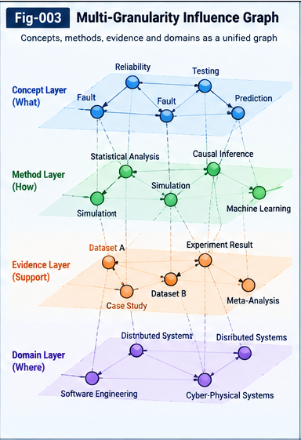

# Figure Index — Autonomous Questioning Structural Intelligence (AQSI)

**Repository:** Autonomous-Questioning-Structural-Intelligence  
**Release track:** v1.0.0 — Initial Research Framework  
**Document status:** Research navigation and figure-insertion specification  
**Scope:** Eight figures, their intended scientific meanings, and manuscript placement

> **Asset-status note (important).** The eight figure names below define the repository's intended **individual** PNG assets. At the time this index was prepared, the working files contained one **eight-panel composite infographic** (`a_wide_infographic_poster_with_eight_labeled_panel.png`), not eight verified standalone files at the paths listed below. The links therefore specify *target repository paths*, not a claim that those eight files already exist. Export and visually review each standalone panel before publishing, or explicitly publish the composite as a separate overview image. Do not rename the composite to one of the individual figure filenames.

## 1. Figure catalog

| ID | Figure | Primary manuscript | Additional placement |
|---|---|---|---|
| Fig-001 | [AQSI Grand Architecture](figures/Fig-001-AQSI-Grand-Architecture.png) | [AQSI-001](docs/AQSI-001-From-Answering-to-Autonomous-Questioning.md) | [AQSI-010](docs/AQSI-010-MVP-Architecture-and-Recursive-Evolution.md), [README](README.md) |
| Fig-002 | [Sources of Autonomous Questions](figures/Fig-002-Sources-of-Autonomous-Questions.png) | [AQSI-002](docs/AQSI-002-Biomimetic-Question-Discovery.md) | [EXT-001](extensions/EXT-001-Question-Ecosystem-and-Meta-Question-Discovery.md) |
| Fig-003 | [Multi-Granularity Influence Graph](figures/Fig-003-Multi-Granularity-Influence-Graph.png) | [AQSI-003](docs/AQSI-003-Multi-Granularity-Structural-Influence-Factors.md) | [SPEC-002](specs/SPEC-002-Structural-Influence-and-Scoring-Contract.md) |
| Fig-004 | [Historical Question Intelligence](figures/Fig-004-Historical-Question-Intelligence.png) | [AQSI-004](docs/AQSI-004-Historical-Question-Intelligence-and-Differential-Trees.md) | [CASE-001](cases/CASE-001-Single-Domain-Autonomous-Questioning.md) |
| Fig-005 | [Directional Scoring and Portfolio Selection](figures/Fig-005-Directional-Scoring-and-Portfolio-Selection.png) | [AQSI-005](docs/AQSI-005-Directional-Question-Scoring-and-Portfolio-Selection.md) | [CASE-003](cases/CASE-003-Research-Portfolio-and-Multi-Agent-Relay.md) |
| Fig-006 | [Question Unit and Structural Relay](figures/Fig-006-Question-Unit-and-Structural-Relay.png) | [AQSI-007](docs/AQSI-007-Question-Structural-Relay-and-Collective-Learning.md) | [AQSI-006](docs/AQSI-006-Question-Units-and-Exploration-Contracts.md), [SPEC-003](specs/SPEC-003-Question-Relay-and-Exploration-Lifecycle.md) |
| Fig-007 | [Strategic Question Control Plane](figures/Fig-007-Strategic-Question-Control-Plane.png) | [AQSI-008](docs/AQSI-008-Strategic-Question-Control-Planes.md) | [SPEC-004](specs/SPEC-004-Control-Plane-and-Policy-Conformance.md) |
| Fig-008 | [UTN Cross-Domain Relay and RSI](figures/Fig-008-UTN-Cross-Domain-Relay-and-RSI.png) | [AQSI-009](docs/AQSI-009-UTN-and-Cross-Domain-Question-Transfer.md) | [AQSI-010](docs/AQSI-010-MVP-Architecture-and-Recursive-Evolution.md), [EXT-002](extensions/EXT-002-Cross-Structural-Co-Evolution.md) |

## 2. Individual figure descriptions and insertion guidance

### Fig-001 — AQSI Grand Architecture

**Target file:** `figures/Fig-001-AQSI-Grand-Architecture.png`  
**Primary insertion:** `docs/AQSI-001-From-Answering-to-Autonomous-Questioning.md`, immediately after the introductory description of the AQSI research loop, before detailed component discussions.  
**Secondary insertion:** `docs/AQSI-010-MVP-Architecture-and-Recursive-Evolution.md`, in the architecture overview; optional compact appearance in `README.md`.

**Intended content.** Show the five functional domains—Question Discovery, Structural Representation, Evaluation and Portfolio Selection, Authorized Exploration, and Structural Relay/Evolution—as a closed feedback loop. Historical Question Intelligence, UTN alignment, and the Strategic Question Control Plane are cross-cutting services rather than interchangeable stages. Evidence, counter-evidence, and residuals return to the historical store and generate new candidates.

**Suggested caption:** *Figure 1. Conceptual AQSI architecture: autonomous question discovery and evaluation feed governed exploration; evidence-bearing structural relay closes the learning loop.*

**Interpretation boundary:** A proposed reference architecture, not an implementation or proof of autonomous scientific discovery.

### Fig-002 — Sources of Autonomous Questions

**Target file:** `figures/Fig-002-Sources-of-Autonomous-Questions.png`  
**Primary insertion:** `docs/AQSI-002-Biomimetic-Question-Discovery.md`, after the taxonomy of question sources and before the candidate-generation workflow.

**Intended content.** Distinguish domain knowledge and literature, unresolved gaps, execution residuals, historical question outcomes, concept associations, cross-domain analogies, human research prompts, and incoming Structural Relay. Converge these heterogeneous inputs into candidate Question Units with provenance. Show both LLM-first and structure-first generation as complementary paths.

**Suggested caption:** *Figure 2. Complementary sources of autonomous question candidates, with explicit provenance and two generation routes: language-first and structure-first.*

**Interpretation boundary:** Biomimetic inspiration is a functional design analogy; it is not a validated model of human cognition.

### Fig-003 — Multi-Granularity Influence Graph

**Target file:** `figures/Fig-003-Multi-Granularity-Influence-Graph.png`  
**Primary insertion:** `docs/AQSI-003-Multi-Granularity-Structural-Influence-Factors.md`, after the definition of structural units and directed influence relations.

**Intended content.** Depict heterogeneous nodes (questions, concepts, attributes, methods, evidence, constraints, residuals, and transfer points), typed by UTN where available. Directed edges encode relationship type, estimated influence, provenance, confidence, and unknown status. The graph must visibly allow asymmetric relations and cross-granularity links. Factor folding produces question-to-question influence estimates without equating association to causation.

**Suggested caption:** *Figure 3. Typed, directed, multi-granularity structural relationships from which question-level influence estimates may be composed.*

**Interpretation boundary:** Unknown edges must not be silently treated as zero; estimated influence does not establish causal effect.

### Fig-004 — Historical Question Intelligence

**Target file:** `figures/Fig-004-Historical-Question-Intelligence.png`  
**Primary insertion:** `docs/AQSI-004-Historical-Question-Intelligence-and-Differential-Trees.md`, after the historical record and Question Differential Tree definitions.

**Intended content.** Show a history of Question Units, structural cores and deltas, prior selection decisions, exploration outcomes, negative results, costs, and delayed descendant value. New candidates retrieve relevant history, receive provisional scores, and may be explored, deferred, or revisited. Subsequent evidence updates history without erasing original provenance.

**Suggested caption:** *Figure 4. Historical Question Intelligence reuses scored question families and exploration outcomes to inform screening, revisitation, and learning.*

**Interpretation boundary:** Historical low scores are defeasible evidence, not permanent proof that a new line of inquiry lacks value.

### Fig-005 — Directional Scoring and Portfolio Selection

**Target file:** `figures/Fig-005-Directional-Scoring-and-Portfolio-Selection.png`  
**Primary insertion:** `docs/AQSI-005-Directional-Question-Scoring-and-Portfolio-Selection.md`, after pairwise directional influence and before portfolio optimization.

**Intended content.** Show a candidate question set, an asymmetric question-to-question influence matrix, historical priors, evidence quality and uncertainty, then a resource-constrained portfolio selector. Include exploitation, exploration, diversity, redundancy, and deferred/revisit options. A goal-open baseline can be illustrated as \(S(q_i)=\sum_{j\ne i}I(q_i\rightarrow q_j)\), with portfolio policies applied separately.

**Suggested caption:** *Figure 5. Directional influence and historical evidence inform question ranking, while portfolio policies govern the allocation of limited research resources.*

**Interpretation boundary:** Goal-open selection means no fixed target question; it does not imply value-free or policy-free selection. Selection is not execution authorization.

### Fig-006 — Question Unit and Structural Relay

**Target file:** `figures/Fig-006-Question-Unit-and-Structural-Relay.png`  
**Primary insertion:** `docs/AQSI-007-Question-Structural-Relay-and-Collective-Learning.md`, after the Relay operator taxonomy.  
**Secondary insertion:** `docs/AQSI-006-Question-Units-and-Exploration-Contracts.md`, following the canonical Question Unit description.

**Intended content.** Center a canonical Question Unit with identity, typed structure, provenance, hypotheses, score references, evidence references, lifecycle state, and governance metadata. Connect it through an Exploration Contract to evidence, counter-evidence, outcomes, and Explicit Leftover. Show derive, split, compose, transfer, refute, revisit, and replicate paths to new or updated Question Units; repeated execution can add evidence without automatically constituting independent corroboration.

**Suggested caption:** *Figure 6. A portable Question Unit participates in authorized exploration and provenance-preserving Structural Relay, producing both findings and successor questions.*

**Interpretation boundary:** Relay acceptance does not certify the scientific truth of a claim.

### Fig-007 — Strategic Question Control Plane

**Target file:** `figures/Fig-007-Strategic-Question-Control-Plane.png`  
**Primary insertion:** `docs/AQSI-008-Strategic-Question-Control-Planes.md`, after the four-layer control-plane model.

**Intended content.** Distinguish Strategic (human goals, constraints, authority), Portfolio (budgets, diversity, research allocation), Tactical (candidate scoring and selection proposals), and Operational (authorized exploration). Show upward reporting of evidence, resource use, policy suggestions, and unresolved issues. A policy proposal must not automatically mutate an authorized policy.

**Suggested caption:** *Figure 7. Four-layer research governance separates human strategic authority from AI question selection and explicitly authorized execution.*

**Interpretation boundary:** Research priority, estimated breakthrough readiness, and action permission are distinct quantities.

### Fig-008 — UTN Cross-Domain Relay and RSI

**Target file:** `figures/Fig-008-UTN-Cross-Domain-Relay-and-RSI.png`  
**Primary insertion:** `docs/AQSI-009-UTN-and-Cross-Domain-Question-Transfer.md`, after the cross-domain transfer workflow.  
**Secondary insertion:** `docs/AQSI-010-MVP-Architecture-and-Recursive-Evolution.md`, in the controlled evolution discussion.

**Intended content.** Show a source-domain Question Unit mapped through UTN type/identity alignment and multi-granularity structural correspondences into a target-domain candidate. Carry source evidence and uncertainty without treating source answers as verified target answers. A separate loop proposes improvements to alignment, scoring, or relay structures; conformance and independent validation gate adoption and rollback.

**Suggested caption:** *Figure 8. UTN-mediated cross-domain question transfer and a separate, gated structural-improvement loop support research into controlled recursive evolution.*

**Interpretation boundary:** Cross-domain transfer is a hypothesis until target-domain evidence is obtained; structural interaction is not verified beneficial co-evolution or ASI.

## 3. Markdown insertion template

From a manuscript under `docs/`, `specs/`, `cases/`, or `extensions/`, use a **relative path one directory upward** to the figure:

```markdown


*Figure 3. Typed, directed, multi-granularity structural relationships from which question-level influence estimates may be composed.*
```

From a root-level document such as `README.md`, use `figures/Fig-001-AQSI-Grand-Architecture.png` without `../`.

Keep figure numbers stable across documents. A repeated figure should retain its original global figure ID rather than acquiring a new ID within each manuscript.

## 4. Production and release checklist

- [ ] Export **eight separate** PNG files with the exact names in Section 1.
- [ ] Confirm that every image depicts the corresponding concept, not merely a decorative title card.
- [ ] Inspect small text, labels, arrows, and edge direction at readable zoom; correct any image-generation spelling errors.
- [ ] Ensure diagrams distinguish *proposed* mechanisms from observed or experimentally verified results.
- [ ] Verify UTN labels, Question Unit fields, control-plane authority, and relay semantics against the corresponding Specifications.
- [ ] Check every figure path and Markdown relative path on GitHub, including case-sensitive filenames.
- [ ] Add meaningful alt text and a descriptive caption to each manuscript insertion.
- [ ] Confirm that examples, numeric scores, and results are identified as illustrative unless supported by actual experiments.
- [ ] If publishing the composite overview poster, give it its own clearly named file and caption; do not present it as eight independent assets.
- [ ] Recheck the figure list in `README.md`, `CONTENTS.md`, and this index before tagging v1.0.0.

## 5. Related navigation

- [README.md](README.md) — research overview.
- [START-HERE.md](START-HERE.md) — reading paths.
- [CONTENTS.md](CONTENTS.md) — complete repository navigation.
- [GLOSSARY.md](GLOSSARY.md) — terminology and non-equivalences.
- [VALIDATION-ROADMAP.md](VALIDATION-ROADMAP.md) — empirical validation.

---

**Research stance:** Specifications before runtime; evidence before claims; open, provenance-preserving Collective Learning. Figures are explanatory research artifacts and do not by themselves validate AQSI performance.

