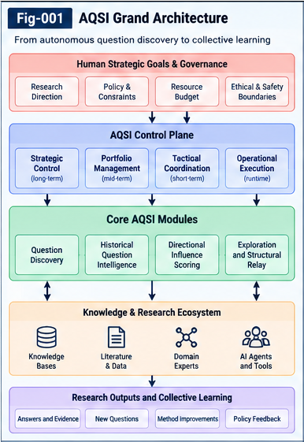

# AQSI-001 — From Answering Questions to Autonomous Questioning Structural Intelligence

**Project:** Autonomous Questioning Structural Intelligence (AQSI)  
**Version:** v1.0.0 — Initial Research Framework  
**Status:** Open research proposal; conceptual architecture and testable hypotheses  
**License:** Apache-2.0

## Abstract

Most deployed AI workflows begin with an externally supplied question, instruction, or objective. Yet the capacity to discover which questions are missing, worth pursuing, and capable of producing reusable knowledge is itself an important research problem. This paper introduces **Autonomous Questioning Structural Intelligence (AQSI)** as a proposed framework for treating questions as explicit, evaluable, executable, and relayable structural units. AQSI integrates question discovery from gaps, residuals, associations, and prior research; multi-granularity structural representations; historical question evaluation; directional scoring and portfolio selection; question formulation and exploration; evidence-aware Structural Relay; and a configurable, human-governed research Control Plane. The objective is not to claim autonomous scientific discovery or artificial superintelligence, but to specify a modular research architecture and a sequence of experiments by which question-driven intelligence growth could be studied. The proposal emphasizes transparent provenance, counter-evidence, resource constraints, replaceable implementations, and collective learning.

**Keywords:** autonomous question generation; structural intelligence; question discovery; multi-granularity relationships; historical question intelligence; structural relay; research governance; recursive improvement; collective learning.

---

*Figure 1. Conceptual AQSI architecture: autonomous question discovery and evaluation feed governed exploration; evidence-bearing structural relay closes the learning loop.*

---

## 1. Introduction: The Missing Half of the Research Loop

A conventional AI interaction is organized around a question or task supplied by a human or an external system:

> External question → AI response → external evaluation → next external question.

This workflow can be useful and powerful, but the selection of the next inquiry often remains outside the AI system. In research, engineering, and collective problem solving, an equally consequential capability is the discovery of *what should be asked next*. A research program can fail not only because an answer is incorrect, but because a critical question was never posed, a hidden dependency was overlooked, or a promising connection between domains remained unexamined.

AQSI proposes to make this question-discovery function explicit. Its motivating loop is:

> Discover candidate questions → represent their structures → evaluate and select → formulate and explore → validate and relay outcomes → discover new questions.

The proposed transition is from predominantly **answer-driven operation** toward **question-driven structural exploration**. This does not eliminate human direction. Rather, it separates strategic governance from the local generation and exploration of research questions.

### 1.1 Research thesis

**Central hypothesis:** A system that represents questions as persistent structural units, evaluates them using multi-granularity relations and historical outcomes, and updates its question intelligence through evidence-aware relay may achieve more useful and efficient exploration than a baseline that generates questions solely through one-off language-model prompting.

This is a hypothesis, not an established empirical result. The comparison requires controlled experiments and independent outcome evaluation.

### 1.2 Scope and non-claims

This document presents an architectural research framework, not a completed runtime, a validated autonomous scientist, or a demonstrated route to AGI or ASI. It does not assert that any particular graph, scoring formula, or language model reproduces the mechanisms of human cognition. The design is intended to support partial implementations, competing algorithms, negative results, and independent replication.

## 2. Why Questioning Is a Distinct Intelligence Function

Questioning is often treated as a subtask of prompt engineering: formulate an effective instruction so that a model produces a useful response. AQSI distinguishes three functions:

1. **Question discovery:** Identify a missing, uncertain, contradictory, or potentially fruitful line of inquiry.
2. **Question evaluation and selection:** Estimate which candidate inquiries merit scarce research resources, including those with uncertain or delayed value.
3. **Question expression and execution:** Convert a selected inquiry into prompts, tool calls, discussions, experiments, or other executable research plans.

Effective prompt expression cannot substitute for discovery. A well-written prompt about an unimportant problem may still waste resources; a poorly expressed but important research question may be worth refining. Consequently, prompt engineering is treated as a downstream component of a broader Question Intelligence system.

### 2.1 Sources of candidate questions

Candidate questions may arise from several partially overlapping mechanisms:

| Source | Structural trigger | Example research operation |
|---|---|---|
| Knowledge gap | Missing explanation or unsupported assumption | Ask what evidence is required |
| Prediction residual | Observed outcome differs from expected outcome | Identify failed model assumptions |
| Task dependency | Required capability or prerequisite is absent | Discover a missing intermediate method |
| Concept association | Potentially useful relationship across units | Test an analogy or transfer point |
| Counter-evidence | Evidence conflicts with an accepted proposition | Reframe or challenge the proposition |
| Structural Relay | A previous exploration creates new residuals | Derive follow-up questions |
| Meta-evaluation | The question-generation process underperforms | Question the discovery or scoring method |

Human questioning provides useful inspiration, but AQSI uses these as engineering hypotheses rather than claims about the exact computational implementation of human thought.

## 3. Questions as Structural Intelligence Units

A question should not be represented only as a natural-language string. A proposed **Question Unit (QU)** may carry:

- Stable identity, namespace, type, domain, and version;
- Natural-language question and machine-readable structural description;
- Concepts, attributes, elements, methods, assumptions, and constraints;
- Relevant historical questions and structural differential references;
- Evidence, counter-evidence, uncertainties, and unresolved residuals;
- Candidate transfer points and cross-domain links;
- Evaluation scores, confidence or uncertainty metadata, and scoring provenance;
- Exploration plans, budgets, permissions, and status;
- Parent, descendant, and peer question references;
- Relay outcomes and subsequent updates.

The unit is **portable in principle** when its contract and references can be interpreted by another implementation. A universal schema is not presumed to exist already. AQSI therefore calls for explicit, versioned contracts and conformance tests.

### 3.1 Multi-granularity relationships

A concept may be decomposed into attributes, components, mechanisms, methods, constraints, transfer points, and evidence records. Relationships can therefore connect not only concept to concept, but method to residual, attribute to attribute, evidence to hypothesis, or structure to structure.

A provisional structural influence function is:

$$
I(q_i,q_j)=operatorname{Fold}_{a,b}\!\left[w_{ab}\,R(h_{ia},h_{jb})\right],
$$

where $h_{ia}$ and $h_{jb}$ are addressable structural units associated with two questions, $R$ evaluates a typed relation, $w_{ab}$ represents contextual and evidential weighting, and **Fold** denotes a specified composition operator. The operator may be additive, constrained, nonlinear, or otherwise task-appropriate. The score can be directional: $I(q_i,q_j)\neq I(q_j,q_i)$.

This formula is a design template, not a calibrated scoring law. Implementations must define relation semantics, normalization, missing-value handling, and evidence provenance.

### 3.2 Universal Typing and Naming (UTN)

Cross-domain comparison requires more than similar words. A proposed UTN-aligned interface can provide stable identity, type, namespace, granularity, and semantic contracts for structural units. It can help distinguish *equivalence*, *analogy*, *dependency*, *causality*, and *possible transfer* rather than treating all relations as similarity. UTN alignment enables candidate transfers; it does not by itself establish that a transfer is valid.

## 4. Historical Question Intelligence

AQSI proposes a historical repository containing questions, their structures, past evaluations, actual exploration outcomes, costs, and downstream relay effects. For a historical set

$$
\mathcal{H}_t=\{(q_i,X_i,S_i,O_i,R_i)\}_{i=1}^{N},
$$

$X_i$ denotes structural features, $S_i$ past assessments, $O_i$ observed outcomes, and $R_i$ relay records. A new question can be evaluated using both its current structural relationships and relevant historical experience.

Historical scores are not assumed to be ground truth. A prior evaluator may have been biased, mistaken, or unable to recognize long-term value. Records should distinguish **predicted value**, **observed result**, and **subsequent attributed value**. Failed attempts may still produce useful evidence or reveal a reusable limitation.

### 4.1 Question Differential Trees

Question Differential Trees can encode how a core question changes through decomposition, reframing, altered assumptions, changed methods, or added constraints. A separate relay graph can preserve temporal derivation and provenance. Keeping structural decomposition distinct from historical lineage avoids forcing all information into a single all-in-one representation.

### 4.2 Resource-aware screening

Historical evaluations can support early filtering of repetitive or low-yield candidates. However, low-scored questions should generally be **deferred with reasons**, not permanently erased. New evidence, methods, or cross-domain links may justify reopening them. Exploration policies should reserve limited capacity for uncertain or poorly represented questions so that historical selection bias does not become self-reinforcing.

## 5. Directional Scoring Without a Preselected Research Question

AQSI distinguishes the absence of a **specific externally selected target question** from the absence of **evaluation criteria**. The former is compatible with autonomous question selection; the latter would make prioritization underdetermined.

For candidate questions $Q=\{q_1,\ldots,q_n\}$, one baseline is a directional pairwise matrix:

$$
M_{ij}=I(q_i,q_j),\qquad S_{\mathrm{group}}(q_i)=\sum_{j\ne i}M_{ij}.
$$

The group score estimates how a question relates to or influences other candidates. It is inexpensive to understand and test, but can favor dense clusters of familiar topics. AQSI therefore treats it as a **baseline**, not an unquestioned optimal selector. Historical evidence, uncertainty, structural novelty, and prospective relay value may be represented within the underlying multi-granularity structure and combined by configurable scoring operators.

A research **portfolio** may allocate resources across near-term opportunities, medium-term capability building, and exploratory high-uncertainty directions. Such allocation is a policy decision, not a universal scoring truth. Methods should be evaluated for coverage, novelty, useful outcomes, and cost—not merely for producing a high internal score.

## 6. Question Expression and Exploration

After selection, a Question Unit is converted into an exploration contract that can specify:

1. The research question, scope, and assumptions;
2. Known evidence and unresolved uncertainties;
3. Requested reasoning, retrieval, simulation, discussion, or experiment;
4. Success criteria and disconfirming observations;
5. Time, compute, tool, and permission limits;
6. Output format, provenance, and relay obligations.

A language model may execute several logical roles—discoverer, critic, explorer, evidence evaluator, and relay curator—without requiring separate models. Multi-agent discussion is an optional extension, not a prerequisite for the first MVP. Agreement among agents sharing the same sources is not independent validation.

## 7. Structural Relay as the Growth Mechanism

A completed exploration should update more than an answer archive. AQSI proposes recording:

- Claims and supporting or conflicting evidence;
- Changes to structural relations and confidence;
- Solved, partially solved, and unresolved portions;
- New candidate questions and their derivation paths;
- Reusable methods, constraints, and transfer points;
- Resource usage, failures, and evaluation feedback.

A question can produce value even without a complete answer, provided the result includes verifiable evidence, a reusable constraint, or a meaningful new inquiry. The system must guard against mistaking proliferating question counts for genuine knowledge growth. Descendant-question value should be attributed carefully to avoid counting the same achievement repeatedly.

The proposed loop is:

$$
Q_t\rightarrow\text{Exploration}_t\rightarrow\text{Evidence/Residuals}_t
\rightarrow\text{Relay Update}_t\rightarrow Q_{t+1}.
$$

Repeated execution may itself be a form of relay when it accumulates informative observations; repetition without new information should not be automatically rewarded.

## 8. A Human-Governed Research Control Plane

Autonomous question discovery need not imply autonomous authority over research goals, budgets, or external actions. AQSI separates a **Strategic Question Control Plane** from the operational Question Intelligence loop.

The Control Plane may specify:

- Research priorities and strategic domains;
- Portfolio budgets and time horizons;
- Allowed tools, data sources, and action permissions;
- Evaluation policies and risk limits;
- Approval requirements for consequential changes;
- Review intervals, stop conditions, and escalation rules.

A policy may prioritize areas with greater estimated near-term breakthrough readiness, while preserving some resources for longer-term exploration. Readiness estimates can draw on existing knowledge, available methods, historical evidence, and cost; they should not be represented as objective predictions of scientific success.

The AI may propose adjustments to research allocations or question-selection policies, but changes to human-controlled mission and authorization boundaries require appropriate approval. Feedback is bidirectional: governance shapes exploration, and exploration supplies evidence for governance review.

## 9. Proposed Minimal Experimental Testbed

The first AQSI MVP should be deliberately modest. One domain, one language model, a small question repository, a simple structural representation, and a traceable scoring-and-relay loop are sufficient to test basic feasibility.

### 9.1 Minimal cycle

1. Import a bounded domain corpus and historical question examples.
2. Generate candidate questions from gaps, residuals, and structural associations.
3. Normalize candidates into Question Units; deduplicate and preserve provenance.
4. Evaluate candidates using historical records and a simple pairwise influence baseline.
5. Select a small portfolio under a fixed resource budget.
6. Execute bounded explorations and record evidence, cost, and unresolved portions.
7. Produce follow-up questions and update the repository.
8. Repeat with versioned evaluation policies and immutable experiment logs.

### 9.2 Baselines

- **A — Direct LLM questioning:** Generate next questions without a persistent structural repository.
- **B — Pairwise structural scoring:** Add a candidate relationship matrix and group ranking.
- **C — Historical and multi-granularity AQSI:** Add typed structural units, historical outcomes, and relay feedback.

Use matched input materials, model access, budgets, and evaluation criteria. Where feasible, independent reviewers should judge the usefulness and validity of discoveries without knowing which system produced them.

### 9.3 Measures

| Measure | Operational question |
|---|---|
| Question validity | Is the question coherent, grounded, and investigable? |
| Substantive novelty | Is it materially distinct from known questions? |
| Verified knowledge gain | Did exploration produce independently supportable new information? |
| Relay yield | Did it create reusable evidence, methods, or productive follow-up questions? |
| Exploration efficiency | What useful outcome was achieved per unit of resource? |
| Cross-domain transfer | Did proposed transfers survive relevant validation? |
| Governance conformance | Did actions remain within authorized policies and budgets? |

The evaluator should report uncertainty and failures, not only aggregate success scores.

## 10. Recursive Improvement and Open-Ended Research

AQSI allows two different levels of proposed improvement:

**Question-level improvement:** Better question formulation, scoring, selection, exploration, and relay under a fixed architecture.

**Generator-level improvement:** Proposed modifications to the structures and algorithms that discover and evaluate questions, including new relation types, alternative scoring operators, and revised transfer mechanisms.

Generator-level changes require versioning, held-out tests, regression checks, and rollback capability. If the generator and evaluator adapt together without independent checks, apparent progress may reflect metric gaming or evaluator drift.

Open-ended growth is a research aspiration. Whether AQSI can sustain broad, verifiable improvements across domains is unknown. Stronger forms of autonomous intelligence would require additional capabilities in world modeling, planning, experimentation, tool use, memory, and governance. This document makes no claim that autonomous questioning alone is sufficient for AGI or ASI.

## 11. Open Problems and Falsifiable Hypotheses

The following hypotheses are proposed for future testing:

- **H1 — Structural representation:** Multi-granularity question structures improve valid candidate discovery relative to text-only question generation under matched budgets.
- **H2 — Historical evaluation:** Historical question outcomes improve prioritization and reduce unproductive repeated exploration relative to no-history baselines.
- **H3 — Directional transfer:** Typed, directional influence relations identify useful cross-domain research transfers missed by symmetric similarity-only scoring.
- **H4 — Relay:** Evidence-aware question relay improves downstream verified knowledge gain compared with retaining only final answer text.
- **H5 — Governance:** A configurable Control Plane can alter research portfolio allocation while preserving question-discovery autonomy and policy conformance.
- **H6 — Recursive improvement:** Controlled updates to question-generation methods yield improvements on held-out evaluation tasks without unacceptable regression or evaluator drift.

Key unresolved issues include the calibration of weak-evidence scores, avoiding history-induced conservatism, separating genuinely new insight from paraphrase, attribution of delayed relay value, reliable UTN alignment, and the cost of evaluating candidate questions at scale.

## 12. Collective Learning and Interoperability

AQSI is intended as a **collective-learning-friendly** research framework. Implementations should be able to replace any proposed graph, scoring, language-model, database, or agent mechanism while retaining inspectable question, evidence, and relay contracts. Negative results, alternative hypotheses, counterexamples, and partial implementations are welcome research contributions.

Related Structural Intelligence lines—such as structural localization, differential representations, Universal Typing and Naming, directional weak-evidence scoring, universal control planes, portable intelligence units, and recursive improvement—are useful design inspirations and possible interoperability partners. They are not mandatory prerequisites for evaluating AQSI independently.

## 13. Conclusion

AQSI proposes that question discovery should be treated as a first-class structural intelligence capability rather than merely an incidental byproduct of answering or prompting. Its core research loop combines autonomous candidate discovery, multi-granularity structural evaluation, historical question intelligence, policy-guided selection, bounded exploration, and evidence-aware Structural Relay.

The immediate contribution is an explicit and testable architecture—not a claim of solved autonomous research. Its value will depend on whether independent experiments demonstrate better questions, more reliable knowledge gains, more effective cross-domain transfer, and improved use of finite research resources. The framework is designed to make those claims measurable, revisable, and open to collective investigation.

---

## Suggested Follow-Up Documents

- **AQSI-002:** Biomimetic Question Discovery
- **AQSI-003:** Multi-Granularity Structural Influence Factors
- **AQSI-004:** Historical Question Intelligence and Differential Trees
- **AQSI-005:** Directional Question Scoring and Portfolio Selection
- **AQSI-006:** Question Units and Exploration Contracts
- **AQSI-007:** Question Structural Relay and Collective Learning
- **AQSI-008:** Strategic Question Control Planes
- **AQSI-009:** UTN and Cross-Domain Question Transfer
- **AQSI-010:** MVP Architecture and Recursive Evolution

*End of AQSI-001 — v1.0.0 research draft.*
