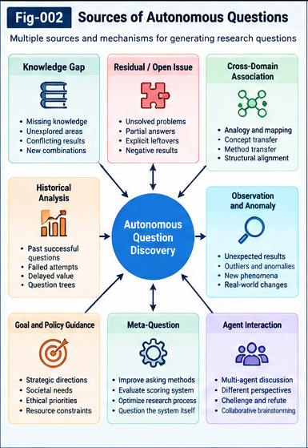

# AQSI-002 — Biomimetic Question Discovery

**Project:** Autonomous Questioning Structural Intelligence (AQSI)  
**Version:** v1.0.0 — Initial Research Framework  
**Status:** Open research proposal; candidate mechanisms and validation design  
**License:** Apache-2.0  
**Companion:** [AQSI-001 — From Answering to Autonomous Questioning](AQSI-001-From-Answering-to-Autonomous-Questioning.md)

## Abstract

The capacity to ask useful questions is not reducible to grammatical question formation. In human inquiry, questions can be triggered by unexpected observations, knowledge gaps, failed predictions, blocked goals, analogies, social exchanges, and the unfinished consequences of earlier work. This paper proposes a **biomimetic-inspired**, but not biologically literal, architecture for autonomous question discovery in Autonomous Questioning Structural Intelligence (AQSI). It separates *question triggers*, *structural candidate generation*, *question expression*, and *evidence-aware feedback*. Four complementary discovery channels—gap-driven, residual-driven, association-driven, and relay-driven—operate over domain knowledge, historical questions, multi-granularity relationships, and research records. A dual pathway combines language-model-first generation with structure-first discovery, while a lightweight Question Candidate Contract preserves provenance, uncertainty, and testability. The proposal includes algorithms, illustrative cases, failure modes, ablations, and falsifiable hypotheses. It does not claim to reproduce human brain mechanisms or to demonstrate autonomous scientific discovery; those claims require independent empirical investigation.

**Keywords:** autonomous questioning; biomimetic inspiration; curiosity; knowledge gaps; residuals; analogical transfer; structural relationships; question discovery; structural relay; question provenance.

---

## 1. Introduction: Asking Is More Than Phrasing

Many AI workflows start after a question has already been selected. Prompt engineering can improve the expression of that question, but it does not by itself explain why the question should exist or why it should be pursued now. A system that produces a fluent list of questions may still fail to discover missing dependencies, promising analogies, or high-value research uncertainties.

AQSI distinguishes the following operations:

1. **Trigger detection:** Recognize a condition that could warrant inquiry.
2. **Question discovery:** Construct a candidate research object from the trigger and available structure.
3. **Question evaluation:** Estimate relevance, potential, cost, uncertainty, and policy compatibility.
4. **Question expression:** Formulate an effective prompt, experiment, or discussion request.
5. **Exploration and relay:** Gather evidence, preserve outcomes and leftovers, and update subsequent discovery.

This paper focuses on the first two operations. Evaluation, control, execution, and recursive improvement are addressed more fully in AQSI-004 through AQSI-010.

### 1.1 Central research proposition

**Hypothesis AQSI-002-H1:** Combining distinct, explicitly represented question-discovery triggers with historical evidence and multi-granularity structure will produce a more useful and diverse candidate pool than one-shot, unstructured language-model question generation under comparable resource budgets.

This is a testable proposal, not an established result.

### 1.2 What “biomimetic” means here

Human questioning is influenced by perception, goals, memory, surprise, social context, and learned expectations. The computational mechanisms are not fully understood, and the proposed graph/tree architecture should **not** be interpreted as a validated model of the human brain. “Biomimetic” here denotes an engineering strategy: identify functional patterns observable in human inquiry and implement approximations that can be measured, replaced, and falsified.

---

## 2. Functional Sources of Human-Like Question Discovery

The following taxonomy is intentionally functional rather than neuroscientific.

| Source | Functional signal | Candidate question form | Main caution |
|---|---|---|---|
| Knowledge gap | Required fact or mechanism is absent | What is missing, and how could it be established? | Unknown does not imply important |
| Prediction mismatch | Observation conflicts with expectation | Which assumption or model failed? | Noisy measurements may be mistaken for anomalies |
| Goal obstruction | A planned action lacks a prerequisite | Which missing capability blocks progress? | The inherited goal may itself be misguided |
| Structural association | Two domains share a relevant feature or mechanism | Can a method from A transfer to B? | Analogy is not evidence of transfer |
| Curiosity / novelty | Unfamiliar or weakly explained pattern appears | What could explain this unusual pattern? | Novelty can reward noise |
| Social / collective exchange | Another participant contributes a challenge or counterexample | What follows from this disagreement? | Repeated model agreement is not independent confirmation |
| Historical relay | Earlier work leaves evidence, failure, or unresolved questions | What should be revisited or reformulated? | Feedback loops can amplify errors |

These triggers are neither exhaustive nor mutually exclusive. One candidate may originate from several sources; provenance should record each rather than force a single label.

---



*Figure 2. Complementary sources of autonomous question candidates, with explicit provenance and two generation routes: language-first and structure-first.*

---

### 2.1 A functional analogy

An observer notices that a process behaves differently from expectation. The difference can become a residual; the residual can be related to prior failures; a structurally analogous method in another domain can suggest an intervention; the proposed intervention can become a question. The architecture models this sequence explicitly while leaving open whether a biological system uses comparable representations.

---

## 3. Four Primary Discovery Channels

### 3.1 Gap-Driven Question Discovery (GDQ)

A **gap** is an explicit or inferred absence relative to a knowledge structure, capability requirement, explanatory model, or research plan. Typical gaps include missing definitions, unresolved dependencies, incomplete causal accounts, unavailable measurements, and incompatible interfaces.

**Proposed process:**

1. Select a domain or research frontier within the authorized scope.
2. Identify a structural object and its known requirements, assumptions, and evidence.
3. Locate missing elements or unresolved dependencies.
4. Convert each significant gap into one or more candidate questions.
5. Preserve the missing element and evidence supporting its classification as a gap.

Example: A software agent can generate code but cannot establish whether a dependency update preserves a security invariant. The useful question is not merely “How can code generation improve?” but “What conformance evidence is required before this dependency update is accepted?”

**Failure mode:** A system may manufacture gaps by treating every absent field as a research problem. Gap significance must be evaluated later, not presumed at discovery time.

### 3.2 Residual-Driven Question Discovery (RDQ)

A **residual** is the unresolved remainder of a comparison, prediction, attempted execution, validation, or structural reconciliation. Residuals are especially valuable because they are anchored in a recorded operation.

A simple representation is:

$$
\rho_t = operatorname{Compare}(\text{expected}_t,\text{observed}_t,\text{context}_t).
$$

The residual need not be numeric. It may be a failed test, a contradictory claim, an unhandled case, or a capability shortfall.

**Candidate transformations:**

- Explanation: Why did this discrepancy occur?
- Localization: Which assumption or component accounts for it?
- Repair: What intervention could reduce it?
- Boundary: Under what conditions does the discrepancy disappear?
- Generalization: Does a similar residual recur in another domain?

**Important distinction:** Residual detection is not proof of a model defect. Measurement error, environmental changes, and incorrect expectations are alternative explanations.

### 3.3 Association-Driven Question Discovery (ADQ)

Association-driven discovery is central to the proposed cross-domain research agenda. It searches for relationships among **multi-granularity structural units**, not merely similarity between top-level concepts.

Candidate units include concepts, attributes, elements, features, methods, constraints, transfer points, evidence, counter-evidence, and historical feedback. A method in one domain may address a residual in another even when the two domain labels are semantically distant.

Let a domain structure contain typed units $U=\{u_1,\ldots,u_m\}$ and typed, evidence-bearing relationships $E$. A candidate cross-domain relation is:

$$
 r=(u_a,operatorname{relation\_type},u_b,operatorname{direction},e,c),
$$

where $e$ identifies supporting or contradicting evidence and $c$ expresses confidence or an explicitly unknown state. The relation may be asymmetric.

**Example:** A historical debugging method that isolates failing prerequisites may be structurally relevant to an experimental research program with unresolved dependencies. The discovery question is: “Can dependency-localization techniques reduce the search space of this experimental bottleneck?” The transfer must be tested rather than inferred from shared vocabulary.

**UTN role:** Universal Typing and Naming (UTN) can provide namespaced identity, types, semantic contracts, and granularity descriptors for comparing otherwise heterogeneous units. UTN alignment is a proposed aid to comparison, not a guarantee of semantic equivalence.

### 3.4 Relay-Driven Question Discovery (LDQ)

Exploration produces more than final answers. It may generate partial findings, failed hypotheses, counterexamples, reusable methods, unexpected side effects, and unanswered follow-ups. Each can trigger further inquiry.

A relay record should preserve:

- Parent question and exploration context.
- Proposed answer or result, with evidence status.
- Validated findings versus tentative claims.
- Residuals and counter-evidence.
- Derived questions and provenance links.
- Resource cost and any relevant stopping decision.

A failed exploration can still generate a useful new question. Conversely, generating many descendants does not itself establish knowledge growth. The relay mechanism must avoid counting repetitive reformulations as independent discoveries.

---

## 4. Multi-Granularity Structure: The Common Substrate

The four channels can share a **Multi-Granularity Structural Relationship Space** while retaining separate specialized representations. This is not a requirement for an all-in-one knowledge graph.

A useful design permits several interoperable views:

| View | Typical representation | Discovery contribution |
|---|---|---|
| Domain knowledge | LLM-accessible corpus, SQL, ontology, graph | Facts, requirements, unresolved explanations |
| Concept / attribute relationships | Typed node-link or hypergraph | Analogies, influence paths, transfer candidates |
| Question differential history | Differential tree / versioned structure | Variants, missing branches, structural reframing |
| Historical evaluations | Tables, models, score records | Prior outcomes, cost, confidence, repeated failures |
| Relay provenance | Event log / lineage DAG | Descendants, evidence, reactivation triggers |
| Control policies | Versioned policy contract | Authorized domain, budget, restrictions |

The important principle is **interoperability through typed references**, not compulsory storage in one representation.

### 4.1 Granularity matters

Two whole-domain concepts can appear unrelated while individual methods, attributes, or constraints have strong structural correspondence. Conversely, a high-level analogy can conceal incompatible assumptions at finer granularity. Discovery should therefore support both top-down and bottom-up search.

### 4.2 Preserve unknown relations

An unobserved link must not automatically be interpreted as a negative link. Record states such as *supported*, *contradicted*, *uncertain*, and *unexamined*. This prevents premature rejection of underexplored directions and supports later re-evaluation.

---

## 5. Two Complementary Candidate-Generation Pathways

### 5.1 Language-Model-First Discovery

The model receives a domain context, known questions, constraints, and selected historical examples. It proposes candidate questions; a structural parser extracts triggers, assumptions, and relevant units.

**Strength:** Fast coverage of implicit linguistic knowledge and flexible phrasing.  
**Risk:** Generic questions, plausible but unsupported links, and repeated patterns from training data.

### 5.2 Structure-First Discovery

The system detects gaps, residuals, novel cross-unit links, or unfinished relay branches **before** asking an LLM to express a question. It constructs a candidate structural relation and only then formulates a natural-language question or experimental request.

**Strength:** Explicit provenance and inspectable discovery paths.  
**Risk:** Dependence on the quality and coverage of the underlying representations.

### 5.3 Hybrid operation

Both pathways feed the same candidate registry. Deduplication and provenance reconciliation occur before expensive exploration. Their performance should be compared through ablation rather than assumed complementary.

---

## 6. Candidate Question Contract (Discovery Stage)

The following illustrative schema is intentionally minimal and not a finalized standard. Full Question Unit contracts are reserved for AQSI-006 and SPEC-001.

```yaml
question_id: "AQSI-Q-0001"
status: "candidate"
origin:
  triggers: ["residual", "association"]
  source_refs: ["experiment-17", "method-registry-4"]
question:
  canonical_text: "Can method X explain residual Y under conditions Z?"
  domain_refs: ["domain-A", "domain-B"]
structure:
  unit_refs: ["utn:method:X", "utn:residual:Y"]
  relation_hypotheses:
    - type: "potential-transfer"
      direction: "X-to-Y"
      evidence_refs: []
      confidence_state: "unexamined"
  assumptions: []
  missing_links: []
validation:
  observable_outcome: "A measurable change in residual Y"
  counterexample_condition: "No improvement over matched baseline"
provenance:
  parent_question_refs: []
  created_by: "candidate-generator-v0"
  policy_version: "research-policy-v1"
```

The contract separates the existence of a question from the validity of its premises. A candidate is a proposal for investigation, not an accepted scientific claim.

---

## 7. Reference Discovery Algorithm

A modular discovery procedure can be expressed as follows:

```text
INPUT:
  domain_context, historical_questions, relationship_views,
  relay_registry, control_policy, generation_budget

1. Load policy scope and available evidence sources.
2. Detect gaps and missing prerequisites.
3. Detect prediction, execution, and validation residuals.
4. Search typed, multi-granularity association and transfer candidates.
5. Read unresolved relay branches and historical question variants.
6. Optionally generate additional candidates directly with an LLM.
7. Normalize candidates into a common discovery contract.
8. Merge near-duplicates without losing provenance or disagreements.
9. Check candidate premises, explicit uncertainty, and policy eligibility.
10. Submit candidates to historical scoring and portfolio selection.

OUTPUT:
  versioned candidate registry with provenance, not a claim of discovery
```

Steps 1–9 belong primarily to discovery and preparation. Step 10 is an interface to the evaluation architecture described in AQSI-004 and AQSI-005. The research Control Plane governs scope, budget, and permissions; it need not specify each question.

### 7.1 Computational pragmatism

A minimum implementation can use a language model, SQLite tables, lightweight typed links, and a small event log. A graph database, full UTN registry, or multi-agent runtime is not required for the first controlled experiment.

---

## 8. Worked Research Examples

### CASE A — Missing software verification prerequisite

**Input:** An AI coding workflow can implement changes but lacks evidence that an update preserves a required invariant.  
**Trigger:** Gap / blocked goal.  
**Candidate:** “Which conformance tests are necessary to establish preservation of the invariant?”  
**Potential relay:** New tests, counterexamples, unresolved failure modes.  
**Validation:** Compare discovered test requirements against an independently curated reference set.

### CASE B — Cross-domain method transfer

**Input:** A research workflow has a difficult-to-localize failure; a separate domain has a method for dependency localization.  
**Trigger:** Association at the *method ↔ residual* level.  
**Candidate:** “Under what conditions can the dependency-localization method reduce the experimental search space?”  
**Potential relay:** Transfer assumptions, measured effects, counterexamples.  
**Validation:** Predefine success metrics and compare with a no-transfer baseline.

### CASE C — Question arising from a failed question

**Input:** A prior question received repeated inconclusive answers with no new evidence.  
**Trigger:** Relay / residual / historical feedback.  
**Candidate:** “Which missing observation would distinguish the competing explanations?”  
**Potential relay:** An experimental discriminant rather than another speculative discussion.  
**Validation:** Determine whether the proposed observation can actually discriminate the hypotheses.

These cases illustrate candidate generation only; they are not reported experimental results.

---

## 9. Discovery Versus Evaluation: An Essential Boundary

Question discovery should produce a sufficiently broad, traceable candidate set. Historical Question Intelligence can then estimate likely value, identify repeated low-yield patterns, and reduce wasteful exploration. Multi-granularity influence factors support this process by comparing more than top-level concept similarity.

However, discovery and scoring should not collapse into an opaque single judgment. If low historical scores prevent a question from ever entering the registry, the system cannot learn that it systematically missed a new class of questions. A practical design preserves **deferred candidates**, confidence states, and reactivation triggers, while allocating only a bounded exploratory budget to low-evidence frontiers.

The proposed system does **not** require a separate heuristic bonus for every phenomenon. Novelty, method transfer, evidence, historical feedback, and downstream relay potential may be represented as typed structural factors and folded by replaceable scoring operators. The selection policy decides how those factors are used.

---

## 10. Common Failure Modes and Countermeasures

| Failure | Why it matters | Proposed safeguard |
|---|---|---|
| Fluent but trivial questions | Wastes exploration budget | Historical outcome screening and duplicate detection |
| False analogies | Generates unsupported transfer hypotheses | Record assumptions; require counterexamples and experiments |
| Over-reliance on known relations | Neglects unexplored frontiers | Preserve unknown states and a bounded exploration portfolio |
| Self-reinforcing question loops | Inflates apparent progress | Independent evidence checks and lineage-aware deduplication |
| Hallucinated source links | Corrupts provenance | Verify source identifiers and evidence availability |
| Confusing uncertainty with a gap | Creates artificial questions | Explicit trigger classification and uncertainty annotations |
| Excessive question proliferation | Increases cost without learning | Resource budgets, stopping rules, and archival states |
| Policy drift | Unauthorized research direction changes | Versioned Control Plane and approval boundaries |
| Biologically overstated claims | Misrepresents the research basis | Functional analogy only; independent cognitive evidence required |

---

## 11. Testable Hypotheses and Evaluation Design

### 11.1 Hypotheses

- **H1 — Trigger diversity:** Four-channel discovery yields more distinct, independently judged useful questions than a one-shot LLM baseline under equal token and time budgets.
- **H2 — Structural transfer:** Multi-granularity association yields more validated cross-domain transfer candidates than concept-label similarity alone.
- **H3 — Historical feedback:** Access to historical question outcomes improves downstream exploration yield per unit cost compared with no-history selection.
- **H4 — Relay value:** Evidence-aware relay produces more valid follow-up questions than continuation prompting without provenance.
- **H5 — Structure-first complementarity:** Hybrid LLM-first and structure-first generation outperforms either pathway alone on at least one prespecified metric without unacceptable cost growth.
- **H6 — Uncertainty preservation:** Explicitly retaining unexamined relations improves recall of later-validated novel questions compared with treating missing links as negative evidence.

### 11.2 Suggested experimental arms

| Arm | Candidate-generation method |
|---|---|
| A | LLM-only one-shot question generation |
| B | LLM + gap and residual triggers |
| C | B + multi-granularity association |
| D | C + historical question and relay retrieval |
| E | D + structure-first and LLM-first hybrid |

Use matched context access, evaluation budgets, and task domains. Run across multiple seeds and domains, with a held-out set of problems not used to tune the discovery logic.

### 11.3 Measurements

Measure candidate validity, structural novelty, cross-domain transfer validity, duplicate rate, independently verified downstream knowledge gain, useful relay descendants, exploration cost, and false-premise rate. Record both direct and delayed benefits, avoiding double-counting descendant outcomes along multiple lineage paths.

### 11.4 Independent judgment

Separate candidate generators from evaluators. Where feasible, blind human or external tool-based assessors to the generating arm. Agreement among agents using similar models is not sufficient validation. Report negative results and sensitivity to evaluator choice.

---

## 12. Interface to the Rest of AQSI

**AQSI-003** develops multi-granularity structural influence factors.  
**AQSI-004** addresses historical question intelligence and differential question representations.  
**AQSI-005** studies directional scoring and goal-open portfolio selection.  
**AQSI-006** specifies persistent Question Units and exploration contracts.  
**AQSI-007** formalizes question-to-question Structural Relay.  
**AQSI-008** defines strategic question governance and resource policies.  
**AQSI-009** explores UTN alignment and cross-domain transfer.  
**AQSI-010** integrates the MVP and bounded recursive evolution roadmap.

None of these integrations requires a single proprietary runtime. Alternative models, graph structures, retrieval methods, scoring operators, and policy implementations should be welcome if they satisfy documented interfaces and evaluation criteria.

---

## 13. Open Research Questions

1. Which trigger categories are genuinely complementary, and which are redundant?
2. At what granularity do association links become informative rather than noisy?
3. How should a system distinguish a missing question from an ill-posed one?
4. When does structure-first generation outperform language-model-first generation?
5. How should historical negative results influence discovery without suppressing unprecedented ideas?
6. What is the smallest evidence package needed to justify a new transfer hypothesis?
7. How can question descendants be valued without rewarding proliferation or double counting?
8. Can a system discover that its own trigger taxonomy is missing an important class?
9. Which properties of human questioning are useful engineering inspirations but poor literal models?
10. How should policy changes alter the discovery search space while preserving historical comparability?

---

## 14. Collective Learning and Research Boundaries

This paper proposes a research architecture rather than a demonstrated model of cognition or a validated autonomous discovery system. Its value depends on reproducible tests, honest accounting of failed transfers, transparent provenance, and the ability of other researchers to replace individual components.

Researchers may contribute new trigger taxonomies, alternative differential structures, cross-domain association methods, counterexamples, datasets, and independent evaluations. A useful contribution need not endorse all of AQSI; a rigorous failure result or a simpler competing mechanism can improve the shared research record.

## 15. Conclusion

Autonomous question discovery can be studied as a set of explicit, interoperable operations: detecting gaps and residuals, identifying multi-granularity associations, recovering unfinished research from relay history, and turning those triggers into traceable candidate questions. Biomimetic inspiration helps organize the functional questions but does not establish a theory of the human brain. The proposed dual-path architecture—LLM-first and structure-first—offers a practical basis for controlled comparison, while historical evaluation, governance, and evidence-aware relay constrain wasteful or misleading exploration.

The immediate objective is modest and concrete: determine whether structured question discovery can produce better candidate research questions, under equal budgets and independent evaluation, than simpler generation baselines. Only empirical results can establish the size and generality of any improvement.

---

*End of AQSI-002 — v1.0.0 research draft.*
