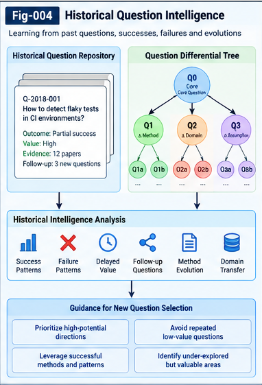

# AQSI-004 — Historical Question Intelligence and Differential Trees

**Project:** Autonomous Questioning Structural Intelligence (AQSI)  
**Version:** v1.0.0 — Research framework  
**Status:** Proposed architecture and testable hypotheses; not an experimentally validated system  
**Scope:** Historical question representation, structural comparison, scoring, exploration triage, and feedback-driven evolution

## Abstract

Autonomous question generation is only one part of an autonomous research process. A useful system must also learn from questions previously asked, the judgments made about them, the resources consumed, the evidence obtained, and the downstream questions or reusable structures they produced. This paper proposes **Historical Question Intelligence (HQI)**: an explicit, provenance-aware memory and evaluation layer for Autonomous Questioning Structural Intelligence (AQSI). It combines a historical question registry, multi-granularity structural representations, **Question Differential Trees (QDTs)**, directional relationship scoring, and outcome-based Structural Relay. The central hypothesis is that historical question experience can improve candidate screening, resource allocation, stopping and revisiting decisions, and cross-domain question transfer compared with question generation without structured history. The design distinguishes *prior expectations* from *observed outcomes*, and treats negative results, unresolved residuals, and deferred questions as first-class records. It proposes contracts, algorithms, illustrative examples, evaluation baselines, and falsifiable hypotheses without claiming empirical superiority.

**Keywords:** autonomous questioning; historical question intelligence; question differential tree; multi-granularity representation; question scoring; research portfolio; structural relay; learning from failure; UTN; recursive improvement.

---

## 1. Motivation: Questioning Should Accumulate Experience

A question-generation system that starts from a blank state in every cycle wastes accumulated research experience. Its past may contain useful signals: which question forms were productive, which methods transferred across domains, which prerequisites were missing, which research paths repeatedly stalled, and which apparently unpromising questions later enabled important discoveries.

AQSI proposes a cycle:

1. Discover or synthesize candidate questions.
2. Represent them as structured, addressable units.
3. Compare them with historical questions and evaluate their likely research value.
4. Select a budgeted exploration portfolio under a configurable Control Plane.
5. Explore, verify, and record outcomes.
6. Relay new evidence, unresolved residuals, derived questions, and evaluation updates into shared memory.

The focus here is steps 2, 3, and 6. **The system should learn not only how to answer, but which questions are worth asking under current conditions.**

### 1.1 Research claims and boundaries

This paper proposes, but does not demonstrate, that structured historical experience may reduce redundant exploration and improve question selection. Historical ratings are not ground truth. They may reflect biased evaluators, incomplete observation, changes in available tools, or short evaluation horizons. A good design therefore preserves evidence, uncertainty, provenance, and opportunities to revisit earlier decisions.

### 1.2 Relationship to adjacent AQSI papers

- **AQSI-001:** overall transition from answering to autonomous questioning.
- **AQSI-002:** biomimetic sources of questions and discovery paths.
- **AQSI-003:** multi-granularity structural influence factors and directional scoring.
- **AQSI-005:** goal-open group scoring and research portfolio selection.
- **AQSI-006/007:** Question Unit contracts, exploration, and Structural Relay.
- **AQSI-008/009:** strategic Control Plane and UTN-based cross-domain alignment.
- **AQSI-010:** MVP integration and recursive evolution.

These are proposed interfaces, not mandatory implementation dependencies.

---

## 2. Historical Question Intelligence: Definition and Scope

**Historical Question Intelligence (HQI)** is the ability to retrieve, compare, evaluate, and update question-related experience using explicit representations of questions and their research trajectories.

An HQI record should distinguish:

- **Question identity:** stable identifier, wording versions, domain, and provenance.
- **Structural description:** concepts, attributes, elements, methods, assumptions, constraints, transfer points, evidence, and residuals.
- **Prior evaluation:** expected usefulness, readiness, cost, uncertainty, and policy context at selection time.
- **Exploration trace:** actions, tools, prompts, resource use, intermediate findings, and stopping decisions.
- **Observed outcome:** validated evidence, failed predictions, counter-evidence, and unresolved issues.
- **Downstream Relay:** derived questions, reusable methods, structural changes, and delayed impacts.
- **Evaluator metadata:** scoring method/version, confidence, calibration, and audit references.

HQI is not simply a vector database of past prompts. It is a **versioned question-experience system** whose records support future evaluation and structural evolution.

### 2.1 Three complementary memories

1. **Semantic memory:** what questions mean and how their components relate.
2. **Episodic research memory:** what happened when a question was explored.
3. **Evaluation memory:** what was predicted, what occurred, and how scoring rules performed.

These memories may be implemented by different structures and storage technologies. AQSI does not require an all-in-one model.

---

## 3. The Canonical Historical Question Record

A minimal interoperable representation may be:

```yaml
question_id: "utn:aqsi:question:Q-001"
revision: 1
status: explored
question:
  text: "Can method A transfer to problem B?"
  domain: "domain-b"
  origin: ["cross_domain_association"]
structure:
  concepts: ["concept-a", "concept-b"]
  attributes: ["constraint-x"]
  methods: ["method-a"]
  assumptions: ["assumption-1"]
  transfer_points: ["transfer-point-1"]
  unresolved_residuals: []
  differential_tree_ref: "utn:aqsi:qdt:T-001"
evaluation_before:
  scorer_id: "baseline-v1"
  score: 0.64
  confidence: 0.45
  estimated_cost: 1200
  cost_unit: "tokens"
  policy_ref: "policy:research-v1"
exploration:
  run_ids: ["run-001"]
  observed_cost: 1050
  stop_reason: "evidence_collected"
outcome:
  validation_status: "partially_verified"
  evidence_refs: ["evidence-001"]
  counter_evidence_refs: []
  direct_value: null
relay:
  derived_question_ids: ["utn:aqsi:question:Q-002"]
  reusable_structure_refs: []
  deferred_residual_ids: []
provenance:
  created_by: "research-agent"
  timestamp: "2026-10-28T00:00:00Z"
```

The values above are illustrative only. A complete contract should specify field semantics, missing-value handling, type alignment, evidence quality, authorization, and lifecycle transitions. A `null` observed value must never be interpreted as zero value.

---

## 4. Question Differential Trees (QDTs)

A **Question Differential Tree** represents a family of related questions through a shared structural core and explicit differences. It is inspired by differential structural representations but is proposed here as a research model, not as an established cognitive account of human questioning.

Let a question have a structural representation:

\[
X(q) = (C,A,M,H,E,R,P)
$$

where $C$ denotes concepts, $A$ attributes, $M$ methods, $H$ assumptions/hypotheses, $E$ evidence, $R$ residuals, and $P$ perspective or policy context. These components may themselves be structured and multi-granular.

For a question family with core $X_0$, a variant is represented as:

\[
X(q_i) = operatorname{Apply}(X_0,\Delta_i)
$$

Here $\Delta_i$ is a typed set of edits, not necessarily numeric subtraction.

### 4.1 Example family

**Core question:** How can an AI system autonomously identify worthwhile research questions?

- **Discovery delta:** Which gaps or residuals should trigger a candidate question?
- **Historical delta:** How should prior question outcomes affect candidate screening?
- **Transfer delta:** Which method from another domain can address an unresolved link?
- **Governance delta:** How should a human research policy constrain exploration?
- **Validation delta:** What evidence would distinguish a useful question from a plausible-sounding one?

### 4.2 QDT node semantics

A node should contain: parent/core reference, typed delta, validity conditions, affected structural units, evidence references, historical score/outcome summaries, and version metadata. Different branches may share substructures. Where a strict tree is inadequate, the QDT should coexist with a **Question Relay Graph**, rather than forcing every many-to-many relation into a tree.

### 4.3 Differential operations

- `specialize`: narrow domain, constraint, or method.
- `generalize`: remove an assumption or widen scope.
- `substitute`: replace method, concept, or perspective.
- `compose`: combine question structures.
- `contradict`: introduce counter-evidence or a conflicting hypothesis.
- `transfer`: map a structural element to another domain.
- `revisit`: reopen a question under changed evidence or capability.

Typed edits allow historical learning at the **transformation level**: a system can learn that certain substitutions or transfer patterns were productive without copying old question wording.

---



*Figure 4. Historical Question Intelligence reuses scored question families and exploration outcomes to inform screening, revisitation, and learning.*

---

## 5. Multi-Granularity Retrieval and Structural Alignment

Historical comparison should not stop at whole-question similarity. A new question may share little surface vocabulary with a past question yet reuse its method, failure mode, constraint, or transfer point.

Candidate retrieval can combine:

1. Lexical and embedding retrieval for broad recall.
2. UTN-guided identity/type/namespace alignment.
3. Structural matching over concepts, attributes, methods, evidence, and residuals.
4. QDT delta comparison over question families.
5. Directional influence and transfer scoring.
6. Historical outcome filtering, with uncertainty and time-awareness.

UTN supplies addressability and candidate type mappings; it does not guarantee semantic equivalence. A cross-domain mapping must carry its assumptions, evidence, and confidence. Missing or unknown relations should remain explicit rather than being assigned an unjustified zero.

### 5.1 Directional transfer

A method previously useful for question $q_i$ may help question $q_j$, even if the reverse transfer is not plausible. Thus, in general:

\[
I(q_i \rightarrow q_j) \neq I(q_j \rightarrow q_i)
$$

A directional score can combine relation type, granularity, historical evidence, and current feasibility through a configurable folding operator. Its exact form is a testable design choice, not a universal law.

---

## 6. Learning to Score New Questions from Historical Experience

Let historical experience at time $t$ be:

\[
\mathcal{H}_t = \{(X_i,\hat{s}_i,y_i,c_i,\pi_i,\tau_i)\}_{i=1}^{N_t}
$$

where $X_i$ is a structured question, $\hat{s}_i$ its pre-exploration estimate, $y_i$ the observed validated outcome, $c_i$ cost, $\pi_i$ selection policy, and $\tau_i$ observation time.

A learned evaluator estimates:

\[
\hat{V}_t(q\mid p,b)=F_{\theta_t}(X(q),\mathcal{H}_t,p,b)
$$

where $p$ is the current policy and $b$ the available budget. $F$ may be a retrieval-based estimator, rules engine, differential tree, statistical model, LLM-assisted evaluator, or ensemble.

### 6.1 Distinguish forecast from outcome

A high initial score is a prediction, not a successful result. Evaluation updates should use evidence and independently assessed outcomes, not merely the evaluator's earlier confidence or agreement among agents.

### 6.2 Multi-criterion outcome records

Instead of collapsing all outcomes immediately into one number, preserve at least:

- validated knowledge or evidence gain;
- reusable structural/method contribution;
- downstream Relay contribution;
- research cost and elapsed time;
- uncertainty, counter-evidence, and evaluator disagreement.

A Control Plane may later select a scoring fold appropriate to a research mission. This keeps historical experience reusable across policy changes.

### 6.3 Calibration

If a scorer predicts a 70% chance of producing a specified verified outcome, its forecasts should be checked against comparable completed trials. Calibration and ranking quality are distinct: a model can rank candidates well while overstating absolute confidence.

---

## 7. Candidate Screening, Budget Control, and Avoiding Unproductive Loops

HQI enables an inexpensive pre-screening stage before resource-intensive discussion or experimentation.

**Proposed screening sequence:**

1. Check identity and semantic near-duplicates.
2. Retrieve related historical question families and structural deltas.
3. Detect repeated failed approaches and already-resolved prerequisites.
4. Estimate expected research value, cost, uncertainty, and transfer potential.
5. Apply Control Plane eligibility, safety, and budget constraints.
6. Select `explore`, `defer`, `reframe`, `merge`, or `reject-with-reason`.
7. Preserve all decisions and their provenance for future review.

The aim is to reduce wasted exploration, **not** to guarantee that the system never follows an unproductive path.

### 7.1 Marginal value and stopping

For an ongoing exploration, define an estimated marginal value of another step:

\[
\Delta \hat V_t(q,k)=\mathbb{E}[V_{k+1}-V_k\mid\mathcal{H}_t]
$$

A possible stopping rule is to pause when the expected incremental benefit falls below a policy-defined resource threshold, subject to uncertainty and minimum exploration requirements. Such estimates may be wrong; a pause should create a revisit condition, not erase the question.

### 7.2 Revisit triggers

Deferred questions may be reopened after:

- a new method or tool becomes available;
- new evidence or counter-evidence arrives;
- a dependency is resolved;
- a cross-domain relation or UTN mapping is discovered;
- the Control Plane changes priorities or budgets;
- the evaluator's confidence or calibration changes materially.

**Explicit Leftover** is a durable research asset, not a failure to clean the queue.

---

## 8. Question-to-Question Relay and Delayed Value

Some questions produce little immediate value but lead to important downstream research. HQI should preserve this genealogy without assuming that every descendant success belongs fully to every ancestor.

A provisional model is:

\[
V_{\mathrm{total}}(q)=V_{\mathrm{direct}}(q)+\lambda V_{\mathrm{downstream}}(q)
$$

The terms must be operationally defined on comparable scales. Downstream credit requires provenance and an attribution method that avoids double counting across multiple parents. Candidate approaches include bounded-depth attribution, discounted contribution, and counterfactual ablations.

### 8.1 Relay events

A Relay event should specify source question(s), operation type, destination question(s), evidence, structural change, agent or tool provenance, validation status, and timestamps.

Useful event types include `derive`, `decompose`, `compose`, `transfer`, `reframe`, `counterexample`, `resolve`, `defer`, `revisit`, and `score_update`.

### 8.2 Repeated execution as Relay

Repeating a question under controlled variation may add useful data even without a new conceptual result. Record the repeated execution conditions and measurements; avoid counting identical restatements as independent evidence.

---

## 9. Historical Experience and Goal-Open Question Selection

AQSI may operate without a single externally specified target question. This does **not** mean it has no evaluation policy or resource constraints. Historical experience can estimate a candidate's likely usefulness, while pairwise question influence estimates its relationship to the current candidate population.

A baseline group score is:

\[
S_{\mathrm{group}}(q_i)=\sum_{j\ne i} I(q_i\rightarrow q_j)
$$

This can be compared with a history-conditioned score $\hat V_t(q_i)$. One experimental fusion is:

\[
S(q_i)=operatorname{Fold}_{p}\big(\hat V_t(q_i),S_{\mathrm{group}}(q_i),U_t(q_i)\big)
$$

where $U_t$ represents uncertainty or unexplored potential and $operatorname{Fold}_p$ is selected by the active policy. This is a proposed family of mechanisms, not a fixed optimal formula.

A portfolio selector should also consider diversity, dependency, shared cost, and budget. Otherwise densely connected, well-studied question clusters may dominate frontier candidates.

---

## 10. An Illustrative Research Trace

Consider a software-engineering research question:

> Can an AI identify which unresolved software defect is most promising to investigate next?

Historical memory contains three question families:

- **Family A:** repeated attempts to reproduce flaky tests, with poor outcomes when environmental evidence was absent.
- **Family B:** dependency-graph localization, with good outcomes when failure traces were available.
- **Family C:** cross-domain anomaly detection, with uncertain but occasionally useful transfer evidence.

A new candidate proposes combining dependency localization with anomaly detection. HQI retrieves method-level and evidence-level links, not just textual similarity. A QDT records the `compose` delta. The scorer predicts moderate value and high uncertainty; the Control Plane allocates a small bounded exploratory budget. The experiment either produces verified localization evidence or an explicit residual, and both outcomes update the historical record.

This trace is a design illustration, **not a reported experiment**. Its value is to make inputs, decisions, and possible falsification points concrete.

---

## 11. MVP Architecture

A minimal implementation can use:

- **SQLite:** question records, runs, ratings, provenance, Relay events, and policy snapshots.
- **JSON/YAML:** canonical Question Unit and QDT node interchange.
- **LLM:** candidate extraction, question expression, structural annotation, and bounded exploration.
- **Retrieval layer:** lexical/embedding retrieval plus typed structural filtering.
- **Scoring layer:** historical baseline, directional relation scorer, and policy-controlled folding.
- **Evaluation harness:** independent evidence checks and comparison against baselines.

No specialized graph database or multi-agent runtime is necessary for the first experiment.

### 11.1 Minimal processing loop

```text
INPUT: domain context, history H, active policy P, exploration budget B

candidates = discover_questions(domain_context, H)
for q in candidates:
    Xq = represent_multigranular(q)
    neighbors = retrieve_historical_structures(Xq, H)
    delta = compare_with_question_families(Xq, neighbors)
    estimate = score_with_history_and_influence(Xq, delta, neighbors)
    record_pre_exploration_estimate(q, estimate, P)

portfolio = select_budgeted_questions(candidates, P, B)
for q in portfolio:
    result = explore_with_limits(q, P)
    evidence = validate_and_record(result)
    relay = derive_and_record_relay(q, evidence)
    update_history(H, q, result, evidence, relay)

update_evaluator_only_after_separate_validation(H)
OUTPUT: versioned question history, evidence, residuals, derived questions
```

### 11.2 Data and evaluation hygiene

Separate the time at which a question was selected from the time at which its outcome became known. Prevent future outcomes from leaking into historical training snapshots. Preserve unsuccessful and deferred candidates where possible to mitigate selection bias. Keep evaluator revisions versioned and reversible.

---

## 12. Validation Design and Baselines

A credible study should use matched candidate pools, controlled budgets, and blinded or independently checked outcome assessment.

**Baselines:**

- **B0 — No history:** LLM-only question generation and selection.
- **B1 — Text history:** retrieve past question text and summaries.
- **B2 — Structured history:** multi-granularity records without QDTs.
- **B3 — QDT + history:** structured history with differential operations.
- **B4 — Full HQI:** QDT, directional influence, Relay feedback, and policy-controlled selection.

**Measures:**

1. Verified research gain per unit cost.
2. Redundant exploration rate.
3. Ranking quality against independently assessed outcomes.
4. Forecast calibration and uncertainty quality.
5. Cross-domain transfer success rate.
6. Delayed Relay yield, with attribution rules.
7. Recovery of deferred questions after new evidence.
8. Diversity and frontier coverage under equal budgets.

Use time-split evaluation, held-out domains, and ablations of QDT, UTN alignment, historical outcomes, and directional scoring. Report both successes and negative results.

---

## 13. Testable Hypotheses

**HQI-H1 — Historical selection advantage.** Under matched budgets, structured historical records improve verified gain per cost over a no-history baseline.

**HQI-H2 — Differential transfer.** QDT-based retrieval improves identification of useful method-level question transfers over text-only retrieval on held-out domains.

**HQI-H3 — Redundancy reduction.** Historical pre-screening reduces repeated low-yield exploration without an unacceptable loss of valuable frontier questions.

**HQI-H4 — Relay feedback.** Incorporating validated downstream Relay outcomes improves future ranking compared with using immediate outcomes alone.

**HQI-H5 — Revisit policy.** Explicit defer-and-revisit rules recover more newly feasible questions than permanent rejection at comparable resource cost.

**HQI-H6 — Calibration.** Versioned outcome-based feedback improves score calibration over static evaluator prompts.

Each hypothesis can fail; negative findings should guide contract and algorithm revisions rather than be filtered out.

---

## 14. Failure Modes and Governance

### 14.1 Historical selection bias

Only explored questions have full outcomes. If exploration was previously biased toward familiar domains, a scorer trained on those outcomes may further suppress unconventional questions. Record the original selection policy and, where feasible, use controlled exploration or propensity-aware analysis.

### 14.2 Self-confirming evaluation

If the same model generates, evaluates, and validates questions, it may reinforce its own errors. Separate scoring from evidence verification and use external tests, independent reviewers, or reproducible artifacts where possible.

### 14.3 Score drift and Goodhart effects

Optimizing question scores may produce questions that look promising to the scorer but add little knowledge. Audit outcome metrics, freeze evaluation sets, and periodically test against independent baselines.

### 14.4 False structural equivalence

UTN type matches and graph similarity do not prove that a method transfers. Keep assumptions and counter-evidence attached to every proposed mapping.

### 14.5 Over-pruning novelty

A high historical threshold may discard novel questions with sparse precedent. Retain a small, policy-controlled exploration budget for uncertain candidates and preserve rejected/deferred records.

### 14.6 Unbounded recursion and resource use

Question generation can recursively proliferate. Apply budgets, depth limits, duplicate checks, stop conditions, and authorized Control Plane rules. Autonomous question selection does not imply autonomous authority to change strategic goals or safety constraints.

---

## 15. Collective Learning and Interoperability

HQI is intended to support collaborative, replaceable research components:

- publish documented Question Unit and Relay event schemas;
- allow alternative scoring engines and QDT representations;
- preserve source attribution, evidence provenance, and version history;
- permit external researchers to contribute counterexamples and failed transfers;
- distinguish public research records from sensitive or proprietary inputs;
- support migration between local and shared registries without requiring one central model.

The core principle is **conformance before runtime**: different implementations should be able to exchange and inspect question experience before claiming end-to-end autonomy.

---

## 16. Open Research Questions

1. Which differential operations are most predictive of useful question transfer?
2. When does a QDT outperform a general graph or simple retrieval index?
3. How should multi-parent downstream discoveries be attributed fairly?
4. What is the right balance between historical exploitation and untested novelty?
5. How can delayed research outcomes be evaluated without hindsight leakage?
6. Which historical features transfer across domains, and which are domain-specific?
7. Can evaluators reliably detect diminishing returns without suppressing breakthroughs?
8. How should the Control Plane revise budgets when historical predictions become miscalibrated?
9. Can the system discover new useful question transformation types and propose UTN extensions?
10. What minimum evidence is needed to classify a generated question as a genuine contribution rather than a paraphrase?

---

## 17. Proposed Research Roadmap

**Phase A — Representation and replay.** Build the historical registry and QDT schema. Replay a small curated set of research trajectories; test identity, provenance, and delta reconstruction.

**Phase B — Historical scoring.** Add retrieval-based estimators and compare with text-only and no-history baselines on time-split records.

**Phase C — Resource-aware selection.** Integrate defer/revisit decisions, costs, uncertainty, and a human-configured policy.

**Phase D — Structural Relay.** Record question descendants, counter-evidence, and validated downstream contributions; evaluate delayed-value attribution.

**Phase E — Controlled recursive improvement.** Propose scorer and representation changes in a sandbox; promote them only after independent conformance and regression tests.

Each phase should publish failures and unresolved residuals as well as successful results.

---

## 18. Conclusion

Historical Question Intelligence offers a proposed mechanism for turning prior questioning experience into a reusable structural resource. Question Differential Trees capture meaningful changes within question families; multi-granularity alignment exposes method-, attribute-, evidence-, and residual-level relations; historical outcomes support screening and resource decisions; and Structural Relay preserves the long-term consequences of exploration. Together, these mechanisms may allow AQSI to ask better questions with less redundant effort while remaining open to unexpected discoveries.

The central research commitment is modest and testable: **a question should not disappear when its first exploration ends, and a new question should not need to ignore what earlier questions have taught the system.**

---

## Appendix A — Suggested Interface Contracts

```text
QuestionRegistry.put(question_unit) -> revision_id
QuestionRegistry.get(question_id, revision?) -> question_unit
QuestionHistory.search(structural_query, time_cutoff, policy?) -> candidates
QuestionDifferential.compare(core, variant) -> typed_deltas
QuestionScorer.predict(question, history_snapshot, policy) -> score_record
QuestionExplorer.execute(question, budget, permissions) -> run_record
EvidenceValidator.assess(run_record) -> evidence_record
QuestionRelay.record(source_ids, event_type, outputs, evidence) -> relay_event
QuestionEvaluator.update(validated_history, heldout_checks) -> candidate_version
```

Every output should include provenance, confidence or missing-value status, and an explicit version where relevant.

## Appendix B — Terminology

- **HQI:** Historical Question Intelligence; accumulated, evaluable question experience.
- **QDT:** Question Differential Tree; shared core plus typed structural question differences.
- **Question Unit:** addressable representation of a research question and its context.
- **Directional Influence:** potentially asymmetric relationship from one question or structural unit to another.
- **Explicit Leftover:** preserved unresolved issue, failure, or deferred opportunity.
- **Relay Yield:** downstream reusable value, measured under a stated attribution rule.
- **UTN:** Universal Typing and Naming; proposed shared typing and addressing interface.
- **Control Plane:** authorized research priorities, policies, budgets, and evaluation constraints.

## Appendix C — Research Positioning

This document is a theory-first proposal for collective investigation. It is not a claim that the described system has been implemented, benchmarked, or shown to achieve autonomous scientific discovery. Researchers are encouraged to replace components, challenge assumptions, contribute negative evidence, and publish reproducible comparisons.
