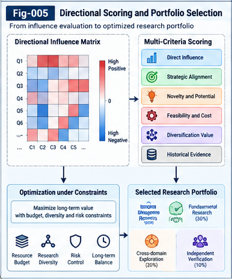

# AQSI-005 — Directional Question Scoring and Portfolio Selection

**Project:** Autonomous Questioning Structural Intelligence (AQSI)  
**Version:** v1.0.0 — Initial Research Framework  
**Status:** Research proposal; algorithms and hypotheses are not empirically validated  
**Document class:** Core research paper  
**License:** Apache-2.0

## Abstract

Autonomous questioning requires more than generating plausible questions. It must decide which questions merit scarce exploration resources while preserving the possibility that unfamiliar, initially weakly scored questions lead to important discoveries. This paper proposes a direction-sensitive, multi-granularity question-scoring and portfolio-selection framework for AQSI. It starts from a *goal-open* baseline: candidate questions are evaluated by their estimated influence on other questions, without requiring a predetermined target question. The framework then integrates historical question intelligence, uncertainty, evidence provenance, and optional strategic research policies. Selection is formulated as a portfolio decision rather than an isolated top-score ranking, accounting for redundancy, diversity, cost, coverage, and delayed relay value. All scoring operators are replaceable, and the framework distinguishes estimated structural influence from demonstrated scientific value. We specify mathematical operators, algorithmic interfaces, governance boundaries, failure modes, and falsifiable evaluation protocols.

**Keywords:** autonomous questioning; directional influence; question portfolio; multi-granularity scoring; goal-open selection; historical question intelligence; structural relay; research governance; uncertainty; structural intelligence

---



*Figure 5. Directional influence and historical evidence inform question ranking, while portfolio policies govern the allocation of limited research resources.*

---

## 1. Motivation: From Question Ranking to Question Portfolios

An autonomous question generator can easily produce more candidates than a research system can examine. Selection must therefore address at least four distinct issues:

1. Which questions are likely to unlock or improve other questions?
2. Which questions deserve attention despite weak or missing historical evidence?
3. Which *sets* of questions jointly offer useful exploration coverage?
4. How should an authorized strategic policy shape allocation without dictating each question?

A simple scalar novelty score is insufficient. Likewise, ranking candidates solely by an LLM's subjective confidence risks self-reinforcing preferences and overlooking structurally novel questions. AQSI instead treats questions as nodes in a typed, evidence-bearing, potentially asymmetric influence system and treats the exploration budget as a portfolio resource.

The central distinction is between **scoring a question in isolation** and **estimating its contribution within a population of questions**. A question with modest direct prospects may have substantial value if answering it clarifies many others, exposes a hidden assumption, or creates a transferable method.

### 1.1 Scope

This document develops the selection layer of AQSI. It relies on candidate discovery in [AQSI-002](AQSI-002-Biomimetic-Question-Discovery.md), structural influence factors in [AQSI-003](AQSI-003-Multi-Granularity-Structural-Influence-Factors.md), and historical question intelligence in [AQSI-004](AQSI-004-Historical-Question-Intelligence-and-Differential-Trees.md). It connects to Question Units and exploration contracts in AQSI-006, structural relay in AQSI-007, strategic control planes in AQSI-008, and UTN-based alignment in AQSI-009.

No claim is made that the proposed scoring function already predicts discoveries or that portfolio optimization guarantees breakthroughs.

## 2. Principles and Boundaries

**P1 — Goal-open is not value-free.** A scoring cycle may have no predetermined target question, but it still uses explicit evaluation criteria, resource limits, and provenance rules.

**P2 — Directionality matters.** Question A may strongly enable question B without B enabling A. Influence must not be silently symmetrized.

**P3 — Multiple granularities share the scoring substrate.** Concepts, attributes, methods, assumptions, evidence, residuals, and transfer opportunities can contribute through typed factors. Arbitrary bonus branches should not substitute for these structural factors.

**P4 — Unknown is not zero.** An unobserved relation must be distinguishable from evidence of negligible influence.

**P5 — Prediction is not outcome.** Estimated influence, anticipated research yield, and validated discoveries must be tracked separately.

**P6 — Historical feedback is useful but biased.** Past decisions determine which outcomes were observed. A history-trained scorer must account for this selection mechanism.

**P7 — Portfolio value is not merely the sum of individual values.** Complementarity, redundancy, sequencing, and diversity change the value of a set.

**P8 — Human authority governs policy.** Strategic constraints and authorization remain separate from autonomous tactical question selection.

**P9 — Residuals are first-class outputs.** Deferred, rejected, or partially explored questions remain recoverable, with reasons and revisit triggers.

## 3. Formal Objects

Let the current candidate pool be

$$
Q_t = \{q_1,\ldots,q_n\}.
$$

A candidate question is represented as a typed Question Unit or a provisional Question Candidate:

$$
q_i = (\mathrm{id}_i, X_i, P_i, E_i, H_i, C_i, L_i),
$$

where:

- \(X_i\) is its multi-granularity structural description;
- \(P_i\) is provenance and generation pathway;
- \(E_i\) is supporting and counter-evidence;
- \(H_i\) references relevant historical questions and outcomes;
- \(C_i\) is estimated exploration cost and resource demand;
- \(L_i\) is lifecycle state, including deferred or revisitable states.

A structural description is a collection of typed factors:

$$
X_i = \{(x_{ia},\tau_{ia},\rho_{ia})\}_{a=1}^{m_i},
$$

where \(\tau\) is a UTN-aligned type and \(\rho\) carries context, granularity, and provenance. A factor may represent a concept, method, measurement, missing relation, assumption, failure mode, evidence item, or prospective transfer point.

An **influence estimate** between questions is a structured object, not just a number:

$$
\widehat{I}_{ij} = (\mu_{ij}, U_{ij}, Z_{ij}, V_{ij}),
$$

where \(\mu_{ij}\) is estimated directional effect, \(U_{ij}\) its uncertainty, \(Z_{ij}\) its supporting factor/evidence trace, and \(V_{ij}\) the estimator and calibration version. Missing estimates are explicitly marked `unknown`.

## 4. Multi-Granularity Directional Influence

### 4.1 Factor-level influence

For factors \(x_{ia}\) and \(x_{jb}\), define a typed directional relationship operator:

$$
r_{ab}^{i\to j} = R_{\theta}(x_{ia},x_{jb}\mid\tau_{ia},\tau_{jb},c_t).
$$

The operator may use explicit rules, structural matching, historical retrieval, learned estimators, LLM-assisted judgments, or mixtures. Its output includes estimated magnitude, sign, confidence, and evidence trace. Relation types might include `enables`, `constrains`, `contradicts`, `shares-method`, `provides-evidence`, `exposes-gap`, and `transfers-to`.

### 4.2 Folding to question-level influence

A configurable folding operator combines the typed factors:

$$
\widehat{I}(q_i\to q_j)
=operatorname{Fold}_{\phi}\left(\{w_{ab}^{i\to j}r_{ab}^{i\to j}\}_{a,b}\right).
$$

The fold must preserve, or explicitly document the loss of, direction, uncertainty, provenance, negative evidence, and unknown factors. A sum is one possible fold, not the universal choice. Alternative folds may be robust, sparse, thresholded, or perspective-aware. Their semantics must be defined in SPEC-002.

In general,

$$
\widehat{I}(q_i\to q_j)\ne\widehat{I}(q_j\to q_i).
$$

For example, a question about the reliability of an experimental measurement may influence several downstream hypotheses, while each downstream hypothesis contributes little to resolving the measurement question.

### 4.3 Signed effects and uncertainty

Positive influence may mean enabling or improving the expected investigation of another question; negative influence may indicate invalidation, interference, or resource conflict. These are not inherently equivalent to “good” and “bad”: a question that disproves a widely shared assumption can have high scientific value even if its signed effect on the viability of dependent questions is negative.

Accordingly, retain separate channels when needed:

$$
\widehat{I}_{ij}^{\mathrm{enable}},\quad
\widehat{I}_{ij}^{\mathrm{challenge}},\quad
\widehat{I}_{ij}^{\mathrm{transfer}}.
$$

A configured perspective may combine these channels, but the underlying evidence should remain inspectable. This avoids a false cancellation of important positive and negative signals.

## 5. Goal-Open Baseline Scoring

The original AQSI baseline scores a question by its directional impact on the other candidate questions:

$$
S_{\mathrm{out}}(q_i;Q_t)=\sum_{j\ne i}\widehat{I}(q_i\to q_j).
$$

This is an interpretable starting point: it does not require choosing a single target question. However, it has limitations. A larger candidate pool mechanically increases score magnitude, redundant questions can inflate scores, and missing relations can be mistaken for low value.

### 5.1 Normalized and coverage-aware alternatives

A weighted average is:

$$
S_{\mathrm{avg}}(q_i)=
\frac{\sum_{j\ne i}a_j\widehat{I}(q_i\to q_j)}
{\sum_{j\ne i}a_j},
$$

where \(a_j\) expresses an explicitly governed importance or sampling weight. This is defined only over eligible, estimated edges, with a separate coverage report. If the denominator is zero, the score is *undefined*, not zero.

A coverage statistic is:

$$
\kappa_i=\frac{|\{j\ne i:\widehat{I}_{ij}\text{ estimated}\}|}{n-1},
$$

for \(n>1\). Coverage should accompany scores, not automatically become an arbitrary score bonus.

### 5.2 Influence reach and indirect effects

Some questions affect others through multi-hop dependencies. For a suitably normalized influence operator \(A\), one candidate extension is:

$$
S_{\mathrm{reach}}(q_i)=\sum_{k=1}^{K}\lambda_k\sum_j(A^k)_{ij}.
$$

This is exploratory. Repeated paths may double-count the same underlying evidence, and signed or uncertain edges complicate interpretation. A practical MVP should begin with direct edges and evaluate multi-hop extensions separately.

### 5.3 When goal-open scoring is inappropriate

A target-free baseline is not appropriate when a binding safety constraint, legal requirement, or authorized time-critical objective demands directed selection. In such cases, the control plane supplies the legitimate perspective and admissible set. Goal-open scoring can still be used within the admissible region.

## 6. Historical Question Intelligence as a Prior

Let historical records be

$$
\mathcal{H}_t=\{(q_h,X_h,A_h,O_h,R_h,T_h)\},
$$

where \(A_h\) records the decision to explore or defer, \(O_h\) the observed result, \(R_h\) the subsequent relay value, and \(T_h\) the observation horizon.

A historical estimator can produce a vector of predicted outcomes:

$$
\widehat{Y}_i=F_{\psi}(X_i,\mathcal{H}_t)
=(\widehat{y}_{\mathrm{yield}},\widehat{y}_{\mathrm{relay}},
\widehat{y}_{\mathrm{cost}},\widehat{u}_{\mathrm{hist}}).
$$

These are predictions, not observed facts. Historical similarity should be typed and multi-granular, including shared methods, evidence patterns, failed assumptions, and transfer relations, rather than only text embedding similarity.

### 6.1 Fusion without double counting

Historical observations may already contribute to structural edge estimates. A naive sum of structural and historical scores can count the same evidence twice. AQSI therefore proposes an **evidence-aware fusion contract**:

$$
\widehat{V}_i=operatorname{Fuse}_{\eta}
\big(S_{\mathrm{out}}(q_i),\widehat{Y}_i,
\mathcal{E}_i,\mathcal{D}_i\big),
$$

where \(\mathcal{E}_i\) tracks evidence lineage and \(\mathcal{D}_i\) records dependencies between estimators. A simple weighted combination is allowed only when its calibration and overlap assumptions are documented.

### 6.2 Selection bias and delayed outcomes

If only high-scoring historical questions were explored, the dataset does not reveal outcomes for the rejected candidates. Evaluation should log decision propensities when feasible, retain deferred candidates, and use prospective randomized exploration budgets to estimate whether the scorer is overlooking valuable questions.

Delayed downstream value must be attributed cautiously. A question that precedes a discovery is not necessarily its cause. Relay contribution should record plausible lineage, uncertainty, and alternative explanations.

## 7. From Individual Scores to Portfolio Selection

Let \(P\subseteq Q_t\) be the selected portfolio and \(B\) the available budget. A generic constrained objective is:

$$
\max_{P\subseteq Q_t}\;F(P\mid\pi_t,\mathcal H_t)
\quad\text{subject to}\quad
\sum_{q_i\in P}c_i\le B,\;P\in\mathcal A(\pi_t),
$$

where \(\pi_t\) is an authorized policy and \(\mathcal A(\pi_t)\) is its admissible portfolio family.

One *illustrative*, non-canonical decomposition is:

$$
F(P)=\sum_{i\in P}\widehat{V}_i
-\alpha\ operatorname{Redundancy}(P)
+\beta operatorname{Coverage}(P)
+\gamma operatorname{Complementarity}(P).
$$

The coefficients are governed configuration choices, not empirically established constants. The decomposition is only valid if its terms have compatible semantics and overlapping evidence is handled. More principled alternatives include multi-objective Pareto selection, submodular coverage, and constrained bandit policies.

### 7.1 Redundancy

Two questions may share wording yet test different mechanisms; conversely, differently worded questions may consume the same experiment. Redundancy should be based on expected overlap in evidence, methods, and outcomes, not merely semantic similarity.

### 7.2 Complementarity and sequencing

A portfolio may require prerequisites. A measurement-calibration question may be valuable because it enables several later experiments. Dependencies can be encoded as ordering or prerequisite constraints rather than folded into an opaque scalar.

### 7.3 Diversity and exploration reserve

A portfolio that maximizes only predicted immediate yield can collapse onto familiar domains. A configurable exploration reserve should admit uncertain, novel, or historically underrepresented question families. This is a governance choice that can be tested, not a claim that novelty always improves outcomes.

### 7.4 Resource realism

Costs may include computation, human expert time, laboratory capacity, data access, ethical review, and elapsed time. A scalar budget is convenient for an MVP; operational systems need multi-resource constraints and explicit non-negotiable safety gates.

## 8. Multi-Stage Selection Pipeline

A practical AQSI pipeline can separate cheap screening from expensive exploration:

**Stage A — Eligibility and integrity.** Validate identity, provenance, minimal Question Unit fields, safety/policy constraints, and known duplicate records.

**Stage B — Historical pre-screen.** Retrieve typed analogues, estimate costs and likely outcomes, and flag repeated failures. Preserve uncertainty and novel out-of-distribution cases.

**Stage C — Structural influence estimation.** Build or update sparse directional edges among candidates, including factor-level evidence and unknown-edge markers.

**Stage D — Goal-open scoring.** Compute direct influence scores, normalization, coverage, and uncertainty summaries.

**Stage E — Portfolio optimization.** Apply authorized policy, resource constraints, redundancy, coverage, prerequisites, and exploration reserve.

**Stage F — Exploration and relay.** Execute question-specific exploration contracts, record evidence/counterevidence, generate derived questions, and update history.

**Stage G — Reassessment.** Revisit deferred questions when new evidence, methods, budgets, or policy conditions alter their prospects.

An early-stage filter should never permanently erase a candidate solely because a historical model assigns it a low score.

## 9. Reference Algorithm (Non-Normative)

```text
INPUT:
    candidates Q, historical records H, authorized policy pi,
    resource budgets B, scoring configurations theta, psi, phi

1. Q_valid, residuals <- validate_and_record(Q, pi)
2. for q in Q_valid:
       hq[q] <- historical_estimate(q, H, psi)
       flag uncertainty, historical selection bias, and novelty
3. Q_screen, deferred <- reversible_screen(Q_valid, hq, pi)
4. E <- estimate_sparse_directional_influences(Q_screen, theta)
       preserve typed factors, evidence lineage, unknown edges
5. for q in Q_screen:
       structural[q] <- fold_outgoing_influence(q, E, phi)
       coverage[q] <- edge_coverage(q, E)
       value[q] <- evidence_aware_fusion(structural[q], hq[q])
6. P <- select_portfolio(Q_screen, value, E, B, pi,
                         redundancy, coverage, prerequisites,
                         exploration_reserve)
7. for q in P:
       result <- explore_under_contract(q)
       append_evidence_counterevidence_and_relay(q, result, H)
8. record selection reasons, costs, deferred candidates,
   failed estimates, residuals, and revisit triggers
9. return P, exploration records, updated H, residual registry
```

This algorithm describes interfaces and responsibilities, not a verified implementation or a universal optimal solver.

## 10. Worked Illustrative Example

Consider four hypothetical research questions:

- **Q1:** How can measurement uncertainty be calibrated across experiments?
- **Q2:** Which hypothesis explains an anomalous observation?
- **Q3:** Can a method from another domain transfer to this anomaly?
- **Q4:** Which interface constraint prevents combining two tools?

Suppose a *toy* directional influence matrix is estimated on a 0–3 illustrative scale:

| From / To | Q1 | Q2 | Q3 | Q4 | Outgoing sum |
|---|---:|---:|---:|---:|---:|
| Q1 | — | 3 | 2 | 1 | 6 |
| Q2 | 1 | — | 1 | 0 | 2 |
| Q3 | 1 | 2 | — | 2 | 5 |
| Q4 | 0 | 1 | 3 | — | 4 |

Here Q1 ranks first by the basic outgoing-sum metric. However, if Q1 and Q3 both require the same costly instrument while Q4 can cheaply unlock a cross-tool integration, a constrained portfolio may select Q1 and Q4 rather than Q1 and Q3. If Q3 is highly uncertain and represents an underexplored transfer route, an exploration reserve may instead justify including Q3.

**Important:** These numbers are invented solely to explain the mechanics; they are not measured results. In a real system each edge requires provenance, relation type, confidence, and an explicit treatment of missing evidence.

## 11. Strategic Question Control Plane

AQSI distinguishes **strategic policy** from **tactical selection**. An authorized human or institution may specify:

- eligible research domains and prohibited activities;
- budget allocations and risk tolerances;
- desired balance of near-term yield, foundational research, and exploration;
- reporting and evidence requirements;
- protected diversity or neglected-area reserves;
- conditions requiring human review.

The control plane may also define a perspective on **breakthrough readiness**, but readiness must be an estimated, auditable construct rather than a declaration that a breakthrough is imminent. The AI remains free to discover and compare concrete questions within these boundaries.

Policy changes must be versioned and recorded with portfolio decisions. An outcome should not be attributed solely to the question scorer if it depended on a major change in strategic allocation.

See AQSI-008 and SPEC-004 for governance contracts.

## 12. Scoring Contracts and Interoperability

A scorer should publish at least:

| Contract field | Meaning |
|---|---|
| `scorer_id` / `version` | Reproducible estimator identity |
| `input_types` | UTN-aligned factor and Question Unit types |
| `direction_semantics` | Meaning of source-to-target influence |
| `output_channels` | Enable, challenge, transfer, or other declared channels |
| `scale` / `normalization` | Units, bounds, comparability assumptions |
| `uncertainty` | Confidence or interval semantics and calibration status |
| `unknown_policy` | How missing or unestimated edges are represented |
| `evidence_lineage` | Source and dependency tracing |
| `folding_operator` | Aggregation rule and information-loss statement |
| `policy_context` | Relevant strategic perspective and restrictions |
| `validation_status` | Proposed, calibrated, tested, or superseded |

A portfolio selector should additionally disclose its budget interpretation, constraints, optimization objective, tie-breaking behavior, exploration reserve, and selection reasons. Conformance is more important than requiring one universal model.

## 13. Structural Relay and Feedback

Each exploration may produce:

1. an answer or partial answer;
2. evidence and counter-evidence;
3. a refined or decomposed question;
4. a newly discovered structural relation;
5. a transferable method or reusable Question Unit;
6. a residual with an explicit reason for deferral or failure.

These outputs update historical question intelligence and the structural influence graph. A newly discovered relation may also motivate a UTN type proposal. Updates must not retroactively rewrite past predictions: retain the prediction snapshot, observed outcome, and subsequent model version separately.

Repeated exploration can itself be a relay event when it adds reproducibility evidence, variance estimates, or boundary conditions. Repetition without new information should be logged honestly rather than automatically credited as progress.

## 14. Failure Modes and Safeguards

| Failure mode | Consequence | Proposed safeguard |
|---|---|---|
| Popularity bias in influence sums | Dense, familiar topics dominate | Normalize, report coverage, sample neglected regions |
| Historical survivorship bias | Unexplored questions appear unpromising | Record propensities, exploration reserve, prospective tests |
| Double counting of shared evidence | Inflated predicted value | Evidence-lineage-aware fusion |
| Unknown treated as zero | Novel relations suppressed | Explicit unknown states and uncertainty |
| LLM self-confirmation | Circular evidence | Independent tests and counter-evidence requirements |
| Metric gaming | High scores without research gain | Outcome-based audits and adversarial evaluation |
| Overaggressive filtering | Valuable long-horizon questions lost | Reversible deferral and revisit triggers |
| Redundancy misclassification | Complementary questions discarded | Method/evidence-level overlap checks |
| Policy overreach | Autonomous discovery replaced by dictated prompts | Separate authority and tactical selection contracts |
| Uncontrolled multi-hop influence | Path amplification and spurious reach | Bounded hops, dependency correction, ablations |
| Unsafe or infeasible experiments | Real-world harm or wasted resources | Non-negotiable safety and feasibility gates |

## 15. Testable Hypotheses

**H1 — Directional advantage.** Under matched resources, directional influence scoring identifies higher-yield prerequisite questions than symmetric similarity scoring.

**H2 — Multi-granularity advantage.** Typed factor-based influence estimates outperform concept-only graphs on cross-domain transfer and missing-link discovery.

**H3 — Historical screening efficiency.** History-informed reversible screening reduces exploration cost per independently verified useful result relative to no historical screening.

**H4 — Portfolio advantage.** Portfolio selection improves verified coverage or downstream relay yield compared with selecting the highest individual scores under the same budget.

**H5 — Exploration reserve.** A bounded reserve increases the discovery of useful out-of-distribution question families without unacceptable loss of near-term validated yield.

**H6 — Governance traceability.** Explicit policy versions and selection rationales improve auditability and reproducibility compared with implicit natural-language guidance alone.

**H7 — Evidence-aware fusion.** Tracking overlapping evidence reduces overconfidence relative to naive additive fusion of historical and structural scores.

Each hypothesis can fail; none should be treated as an established result.

## 16. Validation Design

### 16.1 Baselines

Compare at least:

- **B0:** Random eligible-question selection under budget.
- **B1:** LLM-only direct question ranking.
- **B2:** Semantic similarity or novelty ranking.
- **B3:** Symmetric concept-level graph centrality.
- **B4:** Directional question influence without historical intelligence.
- **B5:** Historical screening without portfolio optimization.
- **B6:** Full proposed pipeline, with ablations.

### 16.2 Evaluation tasks

Use a combination of retrospective benchmark reconstruction and prospective, blinded research tasks. Candidate domains include software debugging, scientific literature hypothesis formation, and cross-domain method transfer. Retrospective tests must prevent leakage of later outcomes into candidate features or historical retrieval.

### 16.3 Metrics

Report independent expert-verified useful outcomes, cost per verified result, downstream question enablement, novel validated transfers, calibration error, false-negative deferral rate, diversity/coverage, time-to-useful-result, and evidence-trace completeness. Distinguish immediate and delayed horizons. Report uncertainty intervals and per-domain breakdowns.

### 16.4 Experimental controls

Fix budgets and candidate pools across methods where possible; randomize assignment of exploration resources; blind outcome judges to scoring method; preregister primary metrics; track human intervention; and preserve negative results. Test sensitivity to pool size, missing-edge rate, history volume, cost estimation error, and policy changes.

### 16.5 Falsification criteria

The approach is weakened if it fails to improve verified outcomes or efficiency over strong baselines, if its claimed directionality adds no predictive information, if exploration reserves consistently reduce outcomes without uncovering neglected value, or if scores cannot be calibrated across domains. An elegant influence graph is not itself evidence of useful autonomous research.

## 17. MVP Roadmap

**M0 — Transparent single-domain baseline.** Build typed Question Units, manually inspectable influence edges, outgoing-sum scoring, budgeted top-k selection, and a residual registry. Establish outcome metrics.

**M1 — Historical intelligence.** Add retrieval from historical question differential trees, reversible screening, outcome prediction, and calibration diagnostics.

**M2 — Portfolio intelligence.** Add cost constraints, redundancy, prerequisites, coverage, and an explicit exploration reserve; run randomized comparisons.

**M3 — Cross-domain transfer.** Use UTN type alignment, cross-domain relation scoring, and transfer-specific evidence contracts.

**M4 — Controlled recursive improvement.** Allow bounded, evaluated updates to scoring/folding/selection policies; retain versioned rollback and independent evaluators.

These are proposed research stages, not a schedule or claim of implementation.

## 18. Open Questions

1. What is the most reliable operational definition of directional influence between research questions?
2. How can enabling, challenging, and transfer effects be compared without erasing their semantics?
3. Which folding operators remain stable when granularity and graph density change?
4. How should unknown relationships be sampled for estimation under limited budgets?
5. How can delayed relay contributions be causally assessed rather than merely correlated?
6. Which portfolio objectives are robust to biased or incomplete historical outcomes?
7. How should exploration reserves adapt when a domain is new or rapidly changing?
8. When should strategic policy constrain the admissible set versus change score weights?
9. Can scorer conformance be standardized without freezing innovation in representation and evaluation?
10. What evidence would justify claiming genuine recursive improvement in question selection?

## 19. Conclusion

AQSI's question-selection problem is fundamentally relational and resource-constrained. A goal-open directional influence score provides a simple and interpretable baseline, but it becomes a credible research mechanism only when paired with typed multi-granularity evidence, historical feedback, uncertainty, and portfolio-level allocation. The proposed architecture deliberately avoids equating high model scores with discoveries. Its value must be established by prospective comparisons on independently verified outcomes, with transparent governance, reversible deferrals, and structural relay of both successes and failures.

The longer-term research proposition is that a system which learns **which questions to ask, in which combinations, and under which constraints** may become a useful component of open-ended structural intelligence. Whether this proposition generalizes beyond particular domains remains an empirical question.

---

## Appendix A — Minimal Score Record (Illustrative)

```yaml
score_record:
  question_id: "utn:aqsi:question:example-001"
  candidate_pool_id: "pool-2026-example"
  scorer_id: "directional-influence-baseline"
  scorer_version: "0.1-proposal"
  policy_version: "policy-example-1"
  outgoing_influence_sum: 6.0
  estimated_edge_coverage: 0.75
  uncertainty_status: "uncalibrated"
  unknown_edges: 1
  evidence_refs:
    - "evidence:illustrative-edge-01"
  historical_estimate:
    status: "insufficient-data"
  portfolio_decision:
    status: "deferred"
    reason: "budget-constrained; revisit after method availability"
    revisit_trigger: "new-measurement-method"
```

All values are illustrative; the schema is not yet normative.

## Appendix B — Suggested Figure

**Fig-005-Directional-Scoring-and-Portfolio-Selection.png** should depict: candidate Question Units → typed directional factor graph → evidence-aware folding → historical calibration → goal-open score/coverage/uncertainty → policy-constrained portfolio selector → exploration and structural relay → history/graph updates. Show unknown edges and deferred/revisit paths explicitly.

## Appendix C — Related AQSI Documents

- `AQSI-001-From-Answering-to-Autonomous-Questioning.md`
- `AQSI-002-Biomimetic-Question-Discovery.md`
- `AQSI-003-Multi-Granularity-Structural-Influence-Factors.md`
- `AQSI-004-Historical-Question-Intelligence-and-Differential-Trees.md`
- `AQSI-006-Question-Units-and-Exploration-Contracts.md`
- `AQSI-007-Question-Structural-Relay-and-Collective-Learning.md`
- `AQSI-008-Strategic-Question-Control-Planes.md`
- `AQSI-009-UTN-and-Cross-Domain-Question-Transfer.md`
- `SPEC-002-Structural-Influence-and-Scoring-Contract.md`
- `SPEC-004-Control-Plane-and-Policy-Conformance.md`

*This document is a theory-first, openly testable proposal. It does not report empirical performance or assert validated autonomous scientific discovery.*
