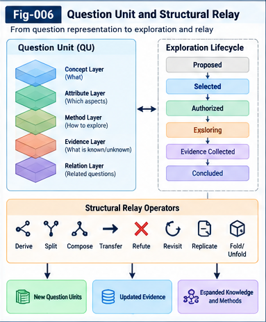

# AQSI-006 — Question Units and Exploration Contracts

**Autonomous Questioning Structural Intelligence (AQSI)**  
**Research framework:** v1.0.0 (theory-first proposal)  
**Status:** Proposed architecture and normative candidate contracts; not an implemented or validated standard  
**Scope:** Canonical question representation, prompt/API expression, exploration lifecycle, evidence handling, governance, and structural relay

## Abstract

Autonomous questioning requires more than generating fluent interrogative sentences. A research question must be represented as an identifiable, typed, provenance-bearing, revisable unit that can be scored, explored, challenged, transferred, and reactivated. This paper proposes the **Question Unit (QU)** as a portable structural research object and an associated family of **Exploration Contracts** that define what an AI or human investigator is authorized to do, what constitutes an admissible observation, and how outcomes are recorded. The proposal connects question discovery and scoring (AQSI-001–005) with Question-to-Question Structural Relay (AQSI-007), strategic governance (AQSI-008), and UTN-based cross-domain transfer (AQSI-009). It separates semantic identity from surface prompt wording, hypotheses from evidence, and exploration execution from evaluation. The contracts are intended to support heterogeneous models, tools, and organizations without imposing a single runtime or ontology. Their effectiveness remains an empirical question.

**Keywords:** Question Unit; exploration contract; autonomous questioning; structural relay; UTN; provenance; evidence; counter-evidence; conformance; research governance.

---

## 1. Motivation: a question is not merely a prompt

A prompt is an interface expression of a question, not necessarily its enduring identity. The same research question may be expressed as a natural-language prompt, a database query, a formal conjecture, an experimental protocol, or a structured tool call. Conversely, two nearly identical prompts may represent materially different research questions because their domains, assumptions, evidence thresholds, or permissible actions differ.

An AQSI system therefore needs a durable unit that can:

1. preserve the research intent and its unresolved structure;
2. record the context and evidence that motivated the question;
3. support multi-granularity, directional influence scoring;
4. invoke different exploration methods under explicit constraints;
5. accumulate positive, negative, inconclusive, and delayed outcomes;
6. relay findings and residual questions to other units and domains; and
7. remain auditable under human-defined research policies.

The proposed Question Unit is the smallest *governable and relayable research object* in AQSI. “Smallest” here is a contract boundary, not a claim that every question is semantically atomic.

## 2. Architectural position

The AQSI workflow is conceptually:

```text
Sources of uncertainty, gaps, residuals, historical questions, cross-domain relations
                |
                v
        Candidate Question Units
                |
                v
  Structural normalization + UTN alignment
                |
                v
 Historical and directional influence evaluation
                |
                v
     Portfolio / policy-aware selection
                |
                v
     Exploration Contract negotiation
                |
                v
  Prompt, API, experiment, simulation, human review
                |
                v
  Evidence / counter-evidence / explicit leftover
                |
                v
       Structural Relay + history update
                |
                +----> revised / descendant / transferred questions
```

This paper specifies the interface between **selection** and **exploration**, as well as the evidence that flows back to the question ecosystem. It does not prescribe one scoring model, LLM, database, or orchestration framework.

## 3. The canonical Question Unit

### 3.1 Conceptual definition

Let a Question Unit at revision `r` be:

$$
QU_i^{(r)} = (ID, T, C, X, P, H, E, S, L, G, V)
$$

where:

- `ID`: stable identity and version lineage;
- `T`: UTN-aligned type and namespace references;
- `C`: research claim, uncertainty, or question intent;
- `X`: multi-granularity structural factors and relationships;
- `P`: provenance, source references, and derivation;
- `H`: hypotheses, assumptions, and proposed falsifiers;
- `E`: evidence, counter-evidence, and unresolved observations;
- `S`: scores, uncertainty, and scorer provenance;
- `L`: lifecycle state and exploration history;
- `G`: governance and resource constraints;
- `V`: validation status and contract/schema version.

These components are *logical roles*, not a mandatory storage layout. Implementations may use a graph, differential tree, document store, relational tables, or a hybrid representation.

### 3.2 Identity, revisions, and semantic equivalence

Each QU needs a persistent identifier and immutable revision identifiers. An edit to wording may preserve identity; a change to the underlying claim or evidence standard may require a new question or a derived-question relationship. Equivalence must be asserted with provenance and confidence, never silently inferred from lexical similarity.

Suggested relations include:

- `rephrases` — alternate expression of the same intended question;
- `refines` — narrows assumptions or scope;
- `generalizes` — expands domain or scope;
- `decomposes_into` — introduces child questions;
- `derived_from` — records an explanatory lineage;
- `contradicts` — captures competing hypotheses;
- `transfers_to` — proposes cross-domain reuse;
- `revisits` — reopens a previously deferred question.

The identity contract must allow **multiple parents**, **multiple representations**, and **non-tree relay links**. Question Differential Trees are useful indexes, not the only permissible topology.

### 3.3 Minimum viable QU

An early implementation should require only:

`id`, `revision`, `question_intent`, `type_refs`, `source_refs`, `assumptions`, `status`, and `governance_ref`.

Other fields may be unknown or deferred. Unknown values should be explicit rather than fabricated to satisfy schema completeness.

---



*Figure 6. A portable Question Unit participates in authorized exploration and provenance-preserving Structural Relay, producing both findings and successor questions.*

---

## 4. Multi-granularity structural representation

A QU may refer to entities and factors at different scales: domain, problem family, concept, attribute, method, mechanism, parameter, observation, evidence, counter-example, residual, and potential transfer point. No single level should be privileged in advance.

For example, a question about why a software system fails to generalize may connect:

- a **domain-level** property: distribution shift;
- a **method-level** factor: retrieval or adaptation policy;
- an **attribute-level** factor: confidence calibration;
- an **evidence-level** factor: failures on held-out tasks;
- a **residual-level** factor: unexplained error clusters;
- a **cross-domain** analogy: biological adaptation under environmental change.

The representation should distinguish a known relation from a hypothesized one, and a missing relation from a measured zero relation.

### 4.1 Directionality and perspective

An influence record can be represented as:

$$
R_{ab}^{(p)}=(h_a,h_b,\rho,p,\hat w,u,e)
$$

where `h_a` and `h_b` are typed structural factors, `ρ` is the proposed relation, `p` is the evaluation perspective, `ŵ` is an estimated influence, `u` is uncertainty, and `e` identifies supporting evidence. In general:

$$
I(q_i \rightarrow q_j) \neq I(q_j \rightarrow q_i).
$$

The QU must preserve the factor-level trace needed to explain aggregated scores. A folded score alone is insufficient for reproducible relay.

## 5. Expression is an adapter, not an identity

A QU may be executed through several **Expression Adapters**:

| Adapter | Typical expression | Suitable for |
|---|---|---|
| Natural-language | Question plus context and constraints | LLM discussion, human review |
| Structured API | Typed request with explicit inputs/outputs | Tool invocation and workflows |
| Database/query | SQL or graph traversal | Retrieval and relation discovery |
| Formal | Conjecture, theorem obligation, constraint | Proof or model checking |
| Experimental | Protocol, intervention, measurements | Empirical validation |
| Simulation | Model, scenario, parameters | Counterfactual exploration |

Adapters must declare semantic coverage and information loss. A short prompt that omits a critical assumption is not an equivalent rendering of the original QU.

### 5.1 Prompt construction contract

A prompt-generation adapter should specify:

1. the precise question or uncertainty;
2. relevant source and structural context;
3. known evidence and counter-evidence;
4. assumptions and explicit unknowns;
5. requested response form;
6. verification or falsification expectations;
7. applicable policy, budget, and tool restrictions.

A model-generated answer must not automatically be treated as validated evidence. It is an **exploration output** whose epistemic status requires classification.

## 6. Exploration Contracts: purpose and layers

An **Exploration Contract (EC)** is an explicit agreement between a Question Unit, an exploration executor, and an evaluator or control plane. It specifies the permitted investigation and the criteria for recording its outcome.

A useful decomposition is:

- **Semantic contract:** What exactly is being investigated? Which assumptions are in scope?
- **Capability contract:** Which tools, data, agents, or experimental methods may be used?
- **Resource contract:** What time, cost, compute, or human-review budget applies?
- **Evidence contract:** What observations and provenance are acceptable?
- **Safety and authority contract:** Which actions require authorization or are prohibited?
- **Output contract:** What must be returned, including failure and leftover information?
- **Relay contract:** How may the result generate or update other questions?

These are independently versionable and can be composed. No contract grants permissions beyond the governing policy.

## 7. Proposed contract structure

The following YAML is **illustrative**, not a finalized standard or an executable configuration:

```yaml
schema: aqsi.exploration-contract/v0.1-proposal
contract_id: ec:software:generalization:trial-004
question_ref:
  id: qu:software:generalization:017
  revision: 3
  utn_type: utn:question/research-uncertainty
intent:
  statement: "Which failure factors persist after retrieval adaptation?"
  assumptions:
    - "Held-out evaluation cases are available"
  explicit_unknowns:
    - "Whether error clusters share a causal mechanism"
execution:
  mode: analysis_and_experiment
  permitted_capabilities:
    - offline_dataset_analysis
    - bounded_model_evaluation
  prohibited_actions:
    - production_deployment
    - external_data_disclosure
  budget:
    compute_hours_max: 2
    human_review_required_for: [external_publication]
evidence:
  required:
    - dataset_version
    - protocol_version
    - measured_outcomes
    - negative_results
  acceptance_rule: "independent evaluator review"
outputs:
  required:
    - observations
    - uncertainty
    - counter_evidence
    - explicit_leftover
    - proposed_relay_links
governance:
  policy_ref: sqcp:research-program:2026-01
  approval_state: proposed
```

A proposed contract is not authorization to execute. The `approval_state` must be verified by the controlling system, not merely supplied by the exploring agent.

## 8. Exploration lifecycle and state transitions

A minimal lifecycle is:

```text
Candidate -> Normalized -> Evaluated -> Selected -> Contracted
                                                   |
                                                   v
                                                Exploring
                                                   |
                         +-------------------------+--------------------+
                         |                         |                    |
                         v                         v                    v
                      Supported               Refuted             Inconclusive
                         |                         |                    |
                         +-------------------------+--------------------+
                                                   |
                                                   v
                                             Relayed / Archived
                                                   |
                                                   v
                                              Revisited (optional)
```

The labels `Supported` and `Refuted` apply to **specific hypotheses under specified evidence conditions**, not to the universal truth or worthlessness of the parent question. Operational states such as `Blocked`, `BudgetExhausted`, `PolicyRejected`, and `ExecutionFailed` must remain distinct from epistemic outcomes.

### 8.1 Transition invariants

1. A QU cannot enter `Exploring` without an applicable approved contract.
2. A completed exploration must emit an outcome record, even if no substantive answer was found.
3. Evidence must be attributable to a source, protocol, and timestamp or version.
4. A revised claim cannot overwrite the original evaluated claim without lineage.
5. A deferred or rejected question remains addressable unless a lawful retention rule requires deletion.
6. A relay edge must identify the originating observation, inference, or residual.
7. Historical scores must preserve the scoring policy/model version used at the time.

## 9. Evidence, counter-evidence, and explicit leftover

AQSI must distinguish at least five evidence classes:

| Class | Meaning | Example |
|---|---|---|
| Observation | Directly recorded result | Measured error rate |
| Derived inference | Reasoned conclusion from observations | Proposed failure mechanism |
| Model suggestion | Unverified generative output | LLM explanation |
| Counter-evidence | Evidence challenging a claim | Failure to reproduce improvement |
| Missing / unknown | Unresolved or unmeasured factor | Absent causal test |

Each record should include provenance, method, scope, uncertainty, and whether it was independently reviewed. Multiple agents repeating the same unsupported assertion do not constitute independent evidence.

**Explicit Leftover** is mandatory at exploration closure. It may include unanswered subquestions, failed methods, untested assumptions, contradictory observations, and potential future experiments. Repeated execution may also produce relay value by accumulating longitudinal evidence, provided repeats are identifiable and not double-counted.

## 10. Exploration results as relayable objects

The outcome of an exploration is not merely `answer: string`. A proposed result envelope is:

$$
ER = (QU\_ref, EC\_ref, M, O, E^+, E^-, U, R, D)
$$

where `M` is method/executor metadata, `O` is observations, `E+` and `E−` are supporting and counter evidence, `U` is uncertainty and leftover, `R` is relay proposals, and `D` is governance/audit decisions.

An outcome can:

- update the same QU's evidence and score history;
- create a child question about a residual;
- split a question into testable subquestions;
- challenge a previous question or assumption;
- transfer a typed mechanism into another domain;
- modify the candidate portfolio without changing strategic authority.

Relay proposals should be independently reviewable. An executor must not silently publish or activate new policies because its answer recommends doing so.


## 11. Interface with Historical Question Intelligence

AQSI-004 proposes historical question records and Question Differential Trees. QU/EC contracts provide the necessary event granularity for learning from them.

A history record should distinguish:

$$
\text{Outcome} = \text{EpistemicResult} \times \text{OperationalResult} \times \text{RelayResult}.
$$

A failed experiment can still yield valuable counter-evidence or a high-value descendant question. Conversely, a fluent answer with no independent evidence may provide little validated knowledge. Scoring systems should preserve these dimensions rather than collapse them into an unqualified success/failure label.

Historical retrieval should match structural factors and UTN types, not only prompt similarity. Selection bias must be addressed because only selected questions receive full exploration outcomes; deferred questions may need periodic sampling or re-evaluation.

## 12. Interface with directional scoring and portfolios

AQSI-003 and AQSI-005 allow pairwise directional influence and portfolio-level selection. A QU therefore exposes **score references** rather than one supposedly universal value:

```text
score_record:
  question_revision
  scorer_id + scorer_version
  perspective + policy_version
  evidence_snapshot
  structural_factor_contributions
  uncertainty / coverage
  timestamp
```

A score is an assessment *under a perspective and evidence snapshot*. It is not an intrinsic property of the question. Unknown pairwise influences should remain unknown rather than default to zero.

Exploration contracts can also require portfolio-level safeguards: reserve exploratory capacity, cap concentration in one domain, or request review before high-cost experiments. The chosen allocation is a policy decision, not a theorem of the scoring formula.

## 13. UTN, semantic interoperability, and portability

UTN provides a proposed mechanism for naming, typing, and aligning heterogeneous structures. A portable QU must distinguish:

- globally or organizationally scoped identifiers;
- type identifiers and schema versions;
- canonical semantic constraints;
- local aliases and natural-language labels;
- equivalence, specialization, and analogy mappings;
- the confidence and evidence supporting each mapping.

A cross-domain transfer should be represented as a **hypothesis of structural correspondence**, not automatic semantic equivalence. If a source-domain method maps to a target-domain concept only approximately, the loss or uncertainty should be visible to downstream scoring and exploration.

Where new question classes or relation types emerge, the system may propose UTN vocabulary evolution. Such proposals require compatibility and governance review before adoption.

## 14. Strategic control and human authority

The Strategic Question Control Plane (SQCP), detailed in AQSI-008, governs research direction, risk, resource budgets, and authority boundaries. The QU identifies what is being asked; the EC determines what may be done about it.

The distinction matters:

- **Strategic autonomy:** humans or authorized institutions choose goals, priorities, and limits.
- **Question autonomy:** AQSI discovers and proposes specific questions within those limits.
- **Execution autonomy:** an agent may conduct only the activities explicitly allowed by its approved contract.
- **Evaluation independence:** an evaluator can challenge the exploring agent's conclusions.

Policies should be explicit, versioned, and auditable. A change to a strategic priority does not retroactively erase historical evidence; it may change how existing questions are scored or selected.

## 15. Multi-agent exploration without consensus inflation

A Question Unit may be explored by multiple agents with distinct roles: proposer, critic, experiment designer, tool executor, evaluator, and curator. Each role should have an explicit contract and authority scope.

An example pattern is:

1. A proposer formulates candidate explanations.
2. A critic identifies counterexamples and confounders.
3. An experiment designer defines discriminating tests.
4. A tool executor runs approved analyses.
5. An evaluator checks evidence quality and contract conformance.
6. A curator creates relay links and updates the historical record.

Agreement among models is not independent verification. Correlated training data, prompts, or shared tool outputs can produce correlated errors. Contracts should record shared dependencies where feasible.

## 16. Failure modes and safeguards

| Failure mode | Why it matters | Proposed safeguard |
|---|---|---|
| Prompt/identity conflation | Rewording fragments history | Stable QU IDs and equivalence links |
| Semantic drift | The question changes during exploration | Immutable revisions and claim checks |
| Fabricated provenance | Unsupported evidence appears credible | Source verification and provenance audit |
| Score laundering | A model's preference is treated as fact | Scorer versions, uncertainty, factor traces |
| Evidence double counting | Correlated observations inflate confidence | Dependency tracking and deduplication |
| Premature closure | Negative results suppress useful questions | Explicit leftover and revisit triggers |
| Unbounded recursion | Question generation consumes resources | Budgeted portfolios and stopping rules |
| Unauthorized action | Research exploration exceeds mandate | Approved capability and policy contracts |
| Cross-domain overreach | Analogies masquerade as equivalences | UTN alignment confidence and target tests |
| Schema rigidity | Novel question forms are excluded | Extensible typed factors and unknown fields |

A contract can improve auditability, but cannot by itself guarantee truthful evidence, safe execution, or meaningful scientific progress.

## 17. Minimal implementation architecture (MVP)

The first implementation should prioritize **conformance before runtime sophistication**:

```text
Question Registry
  -> Type/UTN Alignment Adapter
  -> Structural Factor Store
  -> Historical Retrieval + Scorer
  -> Portfolio Selector
  -> Contract Validator + Policy Gate
  -> Exploration Adapter(s)
  -> Evidence/Counter-Evidence Registry
  -> Relay Registry + Revisit Scheduler
```

### Phase M0: single-domain closed loop

Create a small, manually curated set of questions in one domain. Record typed factors, historical analogues, contracts, results, and leftover. Compare against an unstructured prompt log.

### Phase M1: multiple exploration adapters

Render the same QU into natural-language, structured-query, and experimental forms. Test whether adapters preserve semantic intent and assumptions.

### Phase M2: cross-domain relay

Introduce UTN mappings and evaluate whether typed relay improves useful transfer relative to lexical retrieval, while measuring false analogies.

### Phase M3: recursive contract and question improvement

Allow the system to propose better questions, factor types, or exploration protocols, but require conformance and authorization before deployment. Recursive improvement is a research target, not an assumed outcome.

## 18. Conformance requirements

A future `SPEC-001-Canonical-Question-Unit-Contract.md` should define machine-checkable field requirements and revision semantics. A future `SPEC-003-Question-Relay-and-Exploration-Lifecycle.md` should define event schemas and state transitions.

At minimum, a conforming prototype should demonstrate:

- **C1 — Identity:** a question remains traceable across rewording and revisions;
- **C2 — Provenance:** candidate sources and evidence are attributable;
- **C3 — Semantic preservation:** adapters declare and test omitted assumptions;
- **C4 — Contract gating:** unauthorized exploration is blocked;
- **C5 — Outcome completeness:** inconclusive and failed runs preserve leftover;
- **C6 — Relay lineage:** descendants cite their generating observations;
- **C7 — Historical reproducibility:** prior scores remain tied to their versions;
- **C8 — Revisitability:** deferred questions can be reactivated without losing history;
- **C9 — Unknown preservation:** absent evidence is not silently scored as negative;
- **C10 — Portability:** a QU can be exchanged without requiring the originating runtime.

Conformance should be measured with positive and adversarial fixtures, including malformed provenance, stale policy versions, missing permissions, and ambiguous UTN mappings.

## 19. Testable hypotheses and evaluation design

These are hypotheses, not reported results.

**H1 — Traceability.** QU-based workflows reduce loss of provenance compared with plain prompt histories.

**H2 — Semantic consistency.** Contracted expression adapters preserve more task-critical assumptions across prompt/API variants than unconstrained paraphrasing.

**H3 — Reusable history.** Structured outcome records improve retrieval of relevant past failures and successes compared with lexical-only logs.

**H4 — Counter-evidence preservation.** Mandatory counter-evidence and leftover fields reduce unsupported closure and improve later question revision.

**H5 — Policy conformance.** Explicit capability contracts reduce unauthorized tool use relative to instruction-only controls, subject to implementation quality.

**H6 — Relay utility.** Typed lineage improves the precision of useful derived questions over unstructured brainstorming at matched budgets.

**H7 — Portability.** QU/EC exchange between heterogeneous exploration backends retains more audit-critical context than transferring prompts alone.

### 19.1 Experimental baselines

Compare at least: (A) ordinary prompt log; (B) prompt plus metadata; (C) QU without explicit EC; (D) QU+EC without UTN alignment; and (E) full proposed QU+EC+UTN relay. Hold question corpus, model access, tool budget, and evaluator criteria as constant as practicable.

### 19.2 Metrics

Measure provenance completeness, semantic drift, unauthorized-action rate, evidence quality, unsupported-claim rate, cross-domain transfer precision, delayed relay utility, review burden, latency, and compute cost. Blind expert adjudication is preferable for question usefulness; agreement should be measured and disagreements retained.

### 19.3 Falsification and negative outcomes

The proposal would be weakened if QU/EC structures add substantial cost without improving traceability, conformance, or useful relay; if rigid contracts systematically suppress novel questions; or if human reviewers cannot consistently interpret the fields. Negative results should be published with protocols and counterexamples.

## 20. Open questions

1. What is the smallest useful QU representation across disciplines?
2. When should a semantic revision become a new Question Unit?
3. How can adapter fidelity be evaluated without a perfect semantic oracle?
4. Which evidence-dependency models best prevent double counting?
5. How should exploration contracts encode uncertain, exploratory methods?
6. Can UTN types evolve without destabilizing historical comparisons?
7. How should delayed descendant value affect historical question scores?
8. Which governance policies are portable across institutions, and which are local?
9. How can a system avoid gaming contract-completeness metrics?
10. What is the right balance between contract rigor and open-ended discovery?

## 21. Research boundaries and conclusion

This paper proposes a **contract-based structural interface** between autonomous question discovery and accountable exploration. The central claim is architectural: a question becomes a more useful unit of collective research when its identity, structure, provenance, expression, execution constraints, evidence, and relay lineage are explicit and independently inspectable.

The proposal does **not** demonstrate autonomous scientific discovery, reliable causal inference, recursive self-improvement, or ASI. Those would require separate experimental evidence and governance. AQSI should therefore be treated as an open research program with replaceable components, explicit uncertainty, and falsifiable claims.

Question Units make research questions *portable*. Exploration Contracts make investigations *bounded and reviewable*. Structural Relay makes both results and unanswered questions *available for further learning*. Whether these mechanisms produce meaningful gains is the task of subsequent validation.

---

## Appendix A — Illustrative Question Unit

```yaml
schema: aqsi.question-unit/v0.1-proposal
id: qu:software:generalization:017
revision: 3
status: evaluated
question_intent: "Why does retrieval adaptation fail on some held-out tasks?"
type_refs:
  - utn:question/research-uncertainty
structural_factors:
  - {ref: factor:distribution-shift, type: domain_property}
  - {ref: factor:retrieval-policy, type: method}
  - {ref: factor:failure-cluster, type: residual}
source_refs:
  - observation:heldout-evaluation:v2
assumptions:
  - "The held-out set was not used in training"
hypotheses:
  - id: hyp:017:a
    statement: "Retrieval coverage is insufficient for one task family"
    falsifier: "Matched coverage with unchanged failure rate"
score_refs:
  - score:question-portfolio:2026-01
explicit_unknowns:
  - "Causal contribution of retrieval versus task shift"
governance_ref: sqcp:research-program:2026-01
relay_links:
  - {relation: derived_from, target: qu:software:adaptation:009}
```

All identifiers and values above are illustrative placeholders, not claims of actual experiments or deployed systems.

## Appendix B — Example outcome envelope

```yaml
schema: aqsi.exploration-result/v0.1-proposal
question_ref: {id: qu:software:generalization:017, revision: 3}
contract_ref: ec:software:generalization:trial-004
execution_status: completed
epistemic_status: inconclusive
observations: []
supporting_evidence: []
counter_evidence: []
explicit_leftover:
  - "Need an intervention separating retrieval coverage from distribution shift"
relay_proposals:
  - relation: decomposes_into
    question_intent: "Does controlled retrieval coverage alter the failure cluster?"
review_status: pending
```

## Appendix C — Companion documents and figure placement

**Upstream:** `AQSI-001-From-Answering-to-Autonomous-Questioning.md`; `AQSI-002-Biomimetic-Question-Discovery.md`; `AQSI-003-Multi-Granularity-Structural-Influence-Factors.md`; `AQSI-004-Historical-Question-Intelligence-and-Differential-Trees.md`; `AQSI-005-Directional-Question-Scoring-and-Portfolio-Selection.md`.

**Downstream:** `AQSI-007-Question-Structural-Relay-and-Collective-Learning.md`; `AQSI-008-Strategic-Question-Control-Planes.md`; `AQSI-009-UTN-and-Cross-Domain-Question-Transfer.md`; `AQSI-010-MVP-Architecture-and-Recursive-Evolution.md`.

**Future specifications:** `SPEC-001-Canonical-Question-Unit-Contract.md`; `SPEC-003-Question-Relay-and-Exploration-Lifecycle.md`; `SPEC-004-Control-Plane-and-Policy-Conformance.md`.

---

*AQSI v1.0.0 research series — theory-first, specification-oriented, and open to independent evaluation, counter-evidence, and collective structural learning.*
