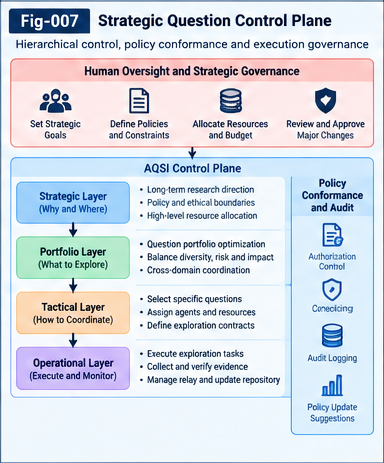

# AQSI-008 — Strategic Question Control Planes

**Project:** Autonomous Questioning Structural Intelligence (AQSI)  
**Version:** 1.0.0 — Initial Research Framework  
**Status:** Research proposal; conceptual governance architecture and testable contracts, not a validated implementation  
**License:** Apache-2.0 (repository-level)  
**Companion papers:** AQSI-001 through AQSI-007; AQSI-009 and AQSI-010  
**Related specification:** `SPEC-004-Control-Plane-and-Policy-Conformance.md` 

## Abstract

Autonomous question discovery and strategic research direction need not be opposing design choices. A research institution may legitimately decide which scientific areas deserve resources, which risks are unacceptable, and which evidence standards are required, while leaving the discovery and evaluation of individual research questions to an autonomous intelligence system. This paper proposes a **Strategic Question Control Plane (SQCP)** for Autonomous Questioning Structural Intelligence (AQSI). SQCP separates human-authorized strategic direction from question-level generation, structural scoring, portfolio selection, exploration, and structural relay. It provides an explicit interface for research priorities, resource envelopes, authorization boundaries, review triggers, and policy provenance.

The proposed architecture distinguishes four interacting layers—strategic, portfolio, tactical, and operational—without treating them as an inflexible hierarchy. It explores how multi-granularity structural influence factors, historical question intelligence, and uncertainty-aware estimates of breakthrough readiness may inform portfolio allocation. It also proposes bidirectional relay: policies shape research exploration, while evidence and unexpected discoveries can inform policy revision through an authorized process. The paper treats research value, breakthrough probability, and long-term societal benefit as uncertain, perspective-dependent quantities rather than objective facts supplied by an AI scorer. The architecture is a research hypothesis requiring empirical and governance evaluation.

**Keywords:** strategic question control plane; autonomous questioning; research governance; human sovereignty; question portfolios; resource allocation; breakthrough readiness; policy conformance; structural relay; collective learning

---

## 1. Motivation: Autonomy Requires Direction Without Micromanagement

A question-generating AI can explore an open-ended space of scientific, technical, or organizational problems. Yet practical research occurs under constraints: time, computation, laboratory capacity, human attention, safety obligations, institutional mandates, and accountability. A university, research funder, public agency, or enterprise may wish to concentrate resources on selected domains while preserving the possibility of unexpected discovery.

Two extremes are inadequate:

1. **Fully prescribed questioning:** a human or institution selects every question, leaving little room for autonomous discovery of hidden gaps, cross-domain connections, and productive residuals.
2. **Unconstrained autonomous allocation:** the AI implicitly determines the institution's goals, values, resource commitments, and acceptable risks through its own scoring function.

SQCP proposes a third arrangement: **authorized strategic guidance with bounded tactical autonomy**. Humans or legitimate governing bodies establish objectives, constraints, and delegated authority. AQSI generates, scores, and explores questions within those boundaries; it may also propose revisions to the boundaries, but does not silently authorize them.

The distinction is foundational:

> **A control plane specifies what the system is authorized to optimize and under which constraints; it need not prescribe which individual questions the system must discover.**

This principle complements the goal-open question scoring of AQSI-005. A question ecosystem may remain open to candidate discovery while its funded portfolio is subject to explicit strategic policies.

## 2. Scope, Terminology, and Non-Claims

### 2.1 Scope

This paper specifies a proposed research-governance layer that connects:

- human or institutional strategic intent;
- question candidate generation and structural representations;
- historical scoring and uncertainty;
- portfolio selection and resource allocation;
- exploration authorization and monitoring;
- evidence, counter-evidence, and policy feedback;
- structural relay across questions, subjects, and domains.

### 2.2 Definitions

- **Strategic Question Control Plane (SQCP):** a policy and governance mechanism that constrains and guides AQSI's question portfolios and exploration activities.
- **Strategic mandate:** an authorized statement of research priorities, exclusions, obligations, and review requirements.
- **Policy envelope:** a versioned, machine-checkable set of limits and preferences derived from a mandate.
- **Question portfolio:** a selected set of Question Units (QUs), potentially with sequencing, dependencies, and budgets.
- **Breakthrough readiness:** an uncertain estimate of whether a research area has conditions favorable to a meaningful advance within a specified horizon; it is not a measured probability unless calibrated against relevant outcomes.
- **Governance residual:** a conflict, ambiguity, or unhandled case that the current policy or control mechanism cannot resolve automatically.
- **Policy relay:** a documented proposal to revise policy based on new evidence, costs, failures, or emerging opportunities.

### 2.3 Non-Claims

SQCP does not claim that an AI can objectively identify the most important national research priorities, that a single score captures social value, that near-term breakthroughs can be reliably predicted, or that strategic guidance guarantees scientific progress. It does not grant the AI authority to redefine institutional goals or to perform consequential external actions without authorization.

## 3. Architectural Separation of Concerns

AQSI distinguishes **question discovery**, **question evaluation**, **portfolio authorization**, **exploration execution**, and **governance feedback**. These functions may be implemented by separate services or by logically isolated modules in one system.

```text
Authorized humans / governing institution
                 |
                 v
      Strategic mandate + policy envelope
                 |
                 v
      STRATEGIC CONTROL PLANE (SQCP)
         priorities / constraints / rights
                 |
                 v
      PORTFOLIO CONTROL PLANE
      allocations / diversity / budgets
                 |
                 v
      TACTICAL QUESTION INTELLIGENCE
      discover -> align -> score -> select
                 |
                 v
      OPERATIONAL EXPLORATION PLANE
      contracts -> tools -> evidence -> review
                 |
                 v
      STRUCTURAL RELAY + HISTORICAL LEARNING
                 |
       evidence, residuals, proposals
                 v
         Governed policy review
```

The diagram describes **logical accountability**, not necessarily a strictly top-down dataflow. Exploration results may update question scores immediately while policy changes remain subject to separate authorization.

## 4. Four Interacting Control Layers

### 4.1 Strategic Layer: Legitimate Direction and Boundaries

The strategic layer answers: *Which directions should the institution pursue, and what authority may it delegate?*

Examples include prioritizing materials research, climate resilience, fundamental mathematics, or accessible health technologies; restricting certain data uses; specifying external-review obligations; and reserving resources for exploratory work.

The strategic layer owns:

- mandate identity and accountable issuer;
- scope, time horizon, and research domains;
- priority preferences and mandatory exclusions;
- legal, ethical, security, and privacy constraints;
- maximum delegated spending and action permissions;
- revision and appeal procedures.

### 4.2 Portfolio Layer: Allocation Across Research Directions

The portfolio layer translates strategic policy into an actionable distribution of research effort. It may balance mature opportunities, uncertain high-upside questions, foundational work, cross-domain transfer, replication, and negative-result follow-up.

Its outputs are **allocations and portfolios**, not irrevocable declarations that certain questions lack value.

### 4.3 Tactical Layer: Autonomous Question Intelligence

The tactical layer discovers and evaluates individual questions using the mechanisms developed in AQSI-002 through AQSI-005: gaps, residuals, associations, relay, multi-granularity influence factors, historical outcomes, and directional scoring.

The tactical layer may autonomously choose between eligible questions. It cannot treat a favorable score as permission to violate the strategic policy envelope.

### 4.4 Operational Layer: Contracted Exploration

The operational layer executes only authorized exploration contracts (AQSI-006). It checks available tools, cost ceilings, data permissions, evidence requirements, stop conditions, and escalation rules. It emits auditable results, including failed attempts and explicit leftovers.

### 4.5 Separation of Scoring and Authority

A crucial invariant is:

$$
operatorname{HighScore}(q)\;\not\Rightarrow\;operatorname{Authorized}(q).
$$

Likewise, a question outside the current funded portfolio is not necessarily unimportant; it may remain archived, unfunded, or eligible for later reconsideration.

---



*Figure 7. Four-layer research governance separates human strategic authority from AI question selection and explicitly authorized execution.*

---

## 5. Canonical Strategic Policy Envelope

A policy envelope should be **versioned, typed, traceable, and inspectable**. The following example is illustrative, not a normative schema.

```yaml
policy_id: aqsi.policy.example.2026-01
policy_version: 1.0
issuer:
  authority_type: research_governance_board
  mandate_reference: mandate-2026-example
  approval_record: approval-001
validity:
  effective_from: 2026-11-01
  review_by: 2027-02-01
scope:
  domains: [materials, energy_systems, foundational_methods]
  eligible_question_types: [hypothesis, method_gap, replication, transfer]
strategic_preferences:
  near_term_opportunities: preferred
  cross_domain_transfer: encouraged
  foundational_research: protected
portfolio:
  total_compute_budget_units: 1000
  protected_exploration_share: 0.20
  maximum_single_domain_share: 0.55
  replication_minimum_share: 0.10
constraints:
  human_approval_for_external_actions: true
  sensitive_data_access: prohibited_without_separate_grant
  unverified_claims_must_be_labeled: true
review:
  escalate_on_policy_conflict: true
  escalate_on_budget_overrun: true
  allow_policy_change_proposals: true
```

The percentages are hypothetical examples, not recommended universal thresholds. Policy validators must check consistency, units, temporal validity, issuer authority, and conflicts between mandatory constraints.

## 6. Strategic Guidance Is Not a Hidden Target Function

AQSI-005 proposes goal-open question evaluation based on structural influence within a candidate ecology. For a candidate set $Q$, an illustrative baseline is:

$$
S_{\mathrm{open}}(q_i)=\sum_{j\ne i} I(q_i\rightarrow q_j),
$$

where $I$ is a directed, multi-granularity influence estimate. This score describes a hypothesized structural role, not verified scientific merit.

A strategic policy $\pi$ can be applied at the **eligibility and portfolio layers** without rewriting the definition of structural influence:

$$
Q_{\pi}=\{q\in Q:operatorname{Eligible}(q,\pi)=1\},
$$

$$
P^*\in\underset{P\subseteq Q_{\pi}}{operatorname{argmax}}
\;U(P\mid\pi,\mathcal H,\mathcal E)
\quad\text{subject to}\quad C_k(P,\pi)\le 0.
$$

Here $\mathcal H$ is historical question intelligence, $\mathcal E$ is current evidence, $U$ is a declared, replaceable portfolio evaluator, and $C_k$ are explicit constraints. This formulation allows multiple legitimate scoring strategies and prevents a strategic preference from being mistaken for an intrinsic truth about a question.

A governance system should distinguish **hard constraints**, **soft preferences**, **protected exploratory allocations**, and **unknown or disputed criteria**.

## 7. Multi-Granularity Strategic Influence

Strategic relevance cannot be reduced to a single keyword match between a question and a policy topic. A question may contribute indirectly through a method, measurement technique, mathematical representation, transferable tool, missing evidence, or shared structural residual.

Let a Question Unit $q$ contain typed structural factors:

$$
X(q)=\{x_1,\ldots,x_m\},
$$

and let a strategic direction $d$ contain policy-relevant factors:

$$
Y(d)=\{y_1,\ldots,y_n\}.
$$

An illustrative directed relevance estimator is:

$$
R(q\rightarrow d)=operatorname{Fold}_{a,b}
\left[w_{ab}\,\rho(x_a\rightarrow y_b\mid\mathcal E,\tau)\right],
$$

where $\tau$ denotes type and semantic alignment, potentially supported by Universal Typing and Naming (UTN). The fold may preserve separate dimensions rather than collapsing them into one number.

Possible factor categories include:

| Factor class | Illustrative relationship | Evidence question |
|---|---|---|
| Concept | Shared theoretical primitive | Is the equivalence semantic or merely lexical? |
| Method | Transferable experimental or computational technique | Has transfer been demonstrated? |
| Attribute | Comparable constraints, properties, or failure modes | Are units and measurement regimes aligned? |
| Residual | A known unsolved obstacle | Would resolving it unlock dependent work? |
| Evidence | Existing positive or counter-evidence | Is it independent and reproducible? |
| Historical feedback | Related question outcomes | Is the historical sample representative? |
| Relay pathway | Potential descendant questions or applications | Is the pathway speculative or observed? |

**Unknown is not zero.** An untested cross-domain link should remain an explicit uncertainty, rather than silently being assigned no strategic relevance.

## 8. Breakthrough Readiness as a Hypothesis, Not an Oracle

An institution may wish to concentrate some effort on areas believed to be close to a meaningful breakthrough. AQSI can investigate a **Breakthrough Readiness Assessment (BRA)**, but must not equate it with a calibrated probability absent evidence.

Potential indicators include:

- existence of a sharply specified bottleneck or residual;
- availability and quality of relevant evidence;
- maturity of enabling methods and instruments;
- tractability of proposed validation experiments;
- historical improvement rate and failed approaches;
- structural dependencies that could be unlocked;
- independent corroboration and reproducibility;
- estimated resource requirements and uncertainty.

A proposed readiness record is a vector:

$$
B(d,t)=\bigl(b_{\mathrm{bottleneck}},b_{\mathrm{evidence}},
 b_{\mathrm{methods}},b_{\mathrm{validation}},b_{\mathrm{dependencies}},
 b_{\mathrm{uncertainty}}\bigr)_{d,t}.
$$

A scalar summary may be produced for a particular decision, but the underlying dimensions, missing values, and calibration status must remain accessible.

### 8.1 Failure of Apparent Readiness

An area with abundant publications and clear benchmarks may appear highly ready simply because it is easy to measure. A neglected area with sparse evidence may have greater eventual impact. Therefore, a policy that maximizes readiness alone risks systematically excluding novel research.

### 8.2 Evidence-Based Calibration

Where historical data are available, assess whether readiness predictions discriminate meaningful outcomes over a fixed horizon. Report calibration error, ranking quality, subgroup/domain differences, and failure cases. Avoid treating an LLM's confidence statement as a measured probability.

## 9. Research Portfolio Design Under Scarcity

A practical SQCP must allocate finite resources. The portfolio should be evaluated as a **set with dependencies**, not merely as the top $k$ individually scored questions.

An illustrative portfolio objective is:

$$
U(P)=\alpha V_{\mathrm{struct}}(P)
+\beta V_{\mathrm{evidence}}(P)
+\gamma V_{\mathrm{diversity}}(P)
+\delta V_{\mathrm{relay}}(P)
-\lambda C(P)-\mu R_{\mathrm{risk}}(P).
$$

All coefficients are declared policy parameters or model parameters, not universal constants. The terms should be separately reported to expose tradeoffs and prevent opaque score laundering.

### 9.1 Complementarity and Dependency

Two low-scoring questions may jointly enable a high-value experiment; two high-scoring questions may be redundant. Portfolio construction should consider directed dependency graphs and combinations.

### 9.2 Protected Exploration

An institution can reserve capacity for uncertain, low-history, or cross-domain questions. This mitigates a feedback loop in which historical success drives all resources toward already established lines of work.

### 9.3 Replication and Negative Results

Replications, failed hypotheses, and counter-evidence gathering may be strategically valuable even when they do not yield a new headline result. They should be eligible portfolio classes rather than invisible overhead.

### 9.4 Multi-Horizon Planning

Separate near-term feasibility from medium-term enabling work and long-term foundational exploration. A single time-discounted score should not be assumed to represent all legitimate research mandates.

## 10. Human Sovereignty and Delegated AI Autonomy

SQCP adopts a **decision-rights separation**:

| Decision | Default accountable authority | Permitted AQSI role |
|---|---|---|
| Establish institutional goals | Authorized human/institution | Analyze alternatives; propose |
| Define prohibited activities | Authorized human/institution | Flag conflicts; recommend |
| Set budget ceilings | Authorized human/institution | Forecast consumption; request changes |
| Generate candidate questions | Delegated AQSI | Execute within scope |
| Rank eligible candidates | Delegated AQSI | Score with disclosed assumptions |
| Select within approved portfolio envelope | Delegated AQSI or human, per mandate | Recommend or execute as delegated |
| Perform external consequential actions | Explicitly authorized operator | Execute only within contract |
| Revise strategic mandate | Authorized human/institution | Submit evidence-backed proposal |
| Archive negative results and residuals | AQSI with governance oversight | Preserve and relay |

The table is a reference model; real institutions may allocate rights differently. What matters is that rights are **explicit, inspectable, and enforceable**, rather than inferred from model capability.

## 11. Bidirectional Question–Policy Relay

Control should not be a one-way instruction stream. Research can reveal that a priority is infeasible, a neglected area is unexpectedly promising, or a mandated metric is misleading.

Two relay directions are therefore distinguished:

**Policy-to-Question Relay:** a strategic mandate is transformed into eligibility rules, portfolio budgets, exploration contracts, and evidence standards.

**Question-to-Policy Relay:** exploration results and structural residuals produce proposals to modify priorities, constraints, or allocations.

The second direction must be **proposal-only** unless the mandate explicitly delegates a narrowly defined change. A policy proposal should include:

1. originating question and exploration contract IDs;
2. supporting evidence and counter-evidence;
3. expected benefits, costs, and affected parties;
4. uncertainty and alternative interpretations;
5. suggested change, expiry/review date, and rollback plan;
6. authorized reviewer and decision record.

This preserves adaptation without allowing the AI to silently move the institution's objectives.

## 12. Historical Question Intelligence and Policy Learning

Historical Question Intelligence (AQSI-004) can help estimate exploration cost, recurrence of failures, reliability of methods, and delayed relay benefits. SQCP adds **policy context** to historical records.

A question outcome should not be labeled globally successful or unsuccessful without specifying the evaluative perspective and time horizon. For example, a question may fail a short-term deployment objective while generating a transferable mathematical technique.

A suggested historical record links:

```text
Question Unit
  -> structural features and UTN identity
  -> policy version and portfolio allocation
  -> exploration contract and resources
  -> observed evidence / counter-evidence
  -> immediate outcome and delayed relay
  -> review decision and subsequent policy proposal
```

Policy-aware historical learning must account for **selection bias**: outcomes are mostly observed for funded questions. Naively training on completed projects may undervalue excluded areas. Retain candidate and deferral records, use exploratory allocations where appropriate, and evaluate off-policy estimates cautiously.

## 13. Multi-Subject and Multi-Institution Governance

Collective learning may involve participants with different mandates, incentives, and access rights. A university, company, public funder, and independent researcher may share structural relay pieces without sharing strategic authority.

A federated AQSI arrangement should distinguish:

- **shared evidence** from **shared priorities**;
- **portable question structure** from **permission to execute**;
- **semantic interoperability** from **policy equivalence**;
- **public results** from **restricted data or proprietary methods**;
- **collective learning** from **collective control**.

UTN and relay contracts may help identify what is transferable. They cannot override local law, confidentiality, consent, or institutional policy. Where mandates conflict, preserve separate perspectives and record the conflict rather than manufacturing a universal consensus score.

## 14. Policy Conformance and Enforcement

A control plane that merely displays policy text is insufficient. Its constraints must be checked at appropriate lifecycle boundaries.

### 14.1 Required Conformance Gates

1. **Mandate gate:** verify issuer, authority, scope, and validity.
2. **Candidate gate:** identify prohibited or out-of-scope candidates; preserve non-sensitive metadata for later review where allowed.
3. **Portfolio gate:** verify allocation, diversity commitments, budget, and dependencies.
4. **Exploration gate:** validate permissions, tool capabilities, data handling, evidence requirements, and stop conditions.
5. **Execution gate:** monitor actual spending and external actions against authorization.
6. **Relay gate:** enforce provenance, confidentiality, and transfer restrictions.
7. **Policy-change gate:** require the designated approver and an auditable decision.

### 14.2 Conformance Invariants

- No exploration contract is executable without an applicable policy decision.
- A question score does not grant execution authority.
- A policy revision cannot be activated solely because the AI proposed it.
- Budget accounting uses explicit units and avoids double counting.
- Expired or revoked authorization is not silently inherited by descendant questions.
- Every material decision records policy version, evaluator version, and evidence references.
- Unknown authorization states fail closed for consequential actions and are surfaced for review.
- Structural relay preserves applicable restrictions or explicitly blocks transfer.

### 14.3 Non-Normative Decision Record

```yaml
decision_id: sqcp.decision.0042
question_unit_id: aqsi.qu.0187
policy_id: aqsi.policy.example.2026-01
policy_version: 1.0
portfolio_id: aqsi.portfolio.09
decision: approved_for_internal_exploration
budget_grant:
  compute_units: 12
  human_review_hours: 2
conditions:
  external_action: requires_separate_approval
  evidence_provenance: required
review_trigger: budget_exceeded_or_policy_conflict
rationale_refs:
  - influence-assessment-0187
  - historical-evidence-0091
  - reviewer-record-0042
```

## 15. Reference Selection and Authorization Procedure

The following pseudocode is a research design, not an executable or validated algorithm.

```text
INPUT:
    candidate_questions Q
    historical_intelligence H
    evidence E
    active_policy pi
    available_resources B

1. Validate authority, scope, and version of pi.
2. For each q in Q:
       align structural features and policy factors using typed mappings;
       compute directional influence and historical estimates;
       preserve uncertainty, unknowns, and evidence provenance;
       classify policy eligibility separately from research merit.
3. Place prohibited candidates outside the executable portfolio.
4. For eligible candidates:
       estimate resource requirements, dependencies, redundancy,
       diversity contribution, and possible relay value.
5. Construct candidate portfolios under hard constraints and B.
6. Compare portfolios under declared multi-perspective evaluators.
7. Reserve exploration and replication capacity as policy requires.
8. Submit portfolio for approval if required by delegated authority.
9. Issue bounded Exploration Contracts for approved questions.
10. Monitor execution; stop or escalate on contract violations.
11. Relay evidence, counter-evidence, failures, and residuals.
12. Update historical records and submit policy-change proposals.
13. Apply policy changes only after authorized review.

OUTPUT:
    authorized portfolio, decision records, exploration contracts,
    residual registry, and policy-review proposals
```

This procedure deliberately separates **evaluating a question** from **authorizing an action**.

## 16. Worked Example: An Illustrative Research Funding Portfolio

Consider a hypothetical public research program with three broad directions: advanced materials, energy systems, and foundational computational methods. The program has a finite computational budget and a mandate to support near-term opportunities without eliminating speculative work.

AQSI generates four candidate questions:

| Candidate | Illustrative research question | Structural opportunity | Key uncertainty |
|---|---|---|---|
| Q-A | Can a materials characterization method expose a shared failure mechanism? | Method and evidence transfer | Transfer validity |
| Q-B | Which unresolved measurement residual limits a promising energy experiment? | Bottleneck reduction | Experimental feasibility |
| Q-C | Can a new structural representation connect unrelated optimization problems? | Cross-domain enabling method | Long-horizon value |
| Q-D | Does a previously reported result replicate under changed conditions? | Evidence reliability | Reproducibility |

Suppose Q-B scores highly on near-term readiness, Q-C scores highly on cross-domain structural influence, Q-A has moderate transfer potential, and Q-D offers high evidence quality value. A top-score-only selection might overconcentrate on Q-B. An SQCP-guided portfolio could instead include Q-B, a bounded exploratory study of Q-C, and a replication of Q-D, while deferring Q-A with an explicit revisit condition.

This is a **qualitative example**, not a measured optimization result. Its purpose is to show how a strategic mandate can guide resource allocation without prescribing all questions in advance. The exact portfolio depends on declared policy, evidence, uncertainty, and budget.

## 17. Governance Failure Modes and Safeguards

| Failure mode | Why it matters | Proposed safeguard |
|---|---|---|
| Objective capture | AI scoring silently becomes institutional policy | Separate score, preference, and authorization records |
| Goodhart effects | Readiness metric becomes a target | Multi-metric review, counterevidence, held-out outcomes |
| Historical lock-in | Prior funded work dominates future funding | Protected exploration; selection-bias audits |
| Metric opacity | A single score hides tradeoffs | Expose component factors, uncertainty, evaluator version |
| Authority confusion | Proposal mistaken for approval | Explicit decision rights and signed review records |
| Policy drift | Small automated changes alter mission | Versioning, change thresholds, periodic human review |
| Budget gaming | Costs understated or shifted | Independent accounting and hard execution ceilings |
| Semantic drift | Cross-domain transfer changes policy meaning | UTN alignment checks and provenance |
| Relay leakage | Restricted information crosses boundaries | Policy-aware export controls and access checks |
| Strategic overfitting | Only fashionable near-term domains survive | Long-horizon allocations and independent reviews |
| False breakthrough claims | Speculative readiness presented as fact | Calibration labels and independent validation |
| Review overload | Every decision requires a human | Tiered risk/authority thresholds and batch approvals |

No single safeguard eliminates these risks. Governance should be tested against adversarial, ambiguous, and rapidly changing conditions.

## 18. MVP Research Architecture

A minimal SQCP demonstration need not control a real funding agency. It can use a sandboxed research corpus, synthetic policies, and retrospective question portfolios.

**M0 — Policy representation:** implement a typed policy envelope, issuer validation, and decision records; test contradictory and expired policies.

**M1 — Policy-aware ranking:** compare structural question scores against eligibility and strategic relevance; verify that scoring and authorization remain separate.

**M2 — Portfolio allocation:** allocate a fixed budget across several research areas with diversity, exploration, and replication constraints; compare to top-$k$ baselines.

**M3 — Exploration and relay:** simulate or conduct low-risk explorations with Question Units, Exploration Contracts, evidence records, and policy-review proposals.

**M4 — Governed adaptation:** allow proposed policy revisions, but require explicit approval; audit whether the system maintains policy continuity and avoids unauthorized action.

This progression follows **Specifications/Contracts First; Conformance Before Runtime**. Real-world deployment should require additional safety, legal, and institutional review.

## 19. Testable Hypotheses

The following are proposed hypotheses, not empirical findings.

**H1 — Governance separation.** A system with explicit score/authority separation will exhibit fewer unauthorized action attempts than a baseline that treats ranking output as executable priority.

**H2 — Portfolio diversity.** Under a fixed resource budget, policy-aware portfolio selection with protected exploration will retain greater diversity of question types and domains than a purely greedy top-score baseline.

**H3 — Multi-granularity relevance.** Typed structural relevance features will identify more defensible indirect contributions to strategic directions than keyword-only policy matching, when evaluated by blinded experts.

**H4 — Historical calibration.** Historical Question Intelligence will improve cost and outcome forecasting relative to no-history baselines, provided selection bias and temporal leakage are controlled.

**H5 — Readiness uncertainty.** Explicit uncertainty reporting will improve decision calibration and reduce overconfident breakthrough forecasts relative to point-estimate-only reporting.

**H6 — Bidirectional relay.** Evidence-backed policy proposals will surface more actionable policy adjustments than a one-way control system, without increasing unauthorized policy changes.

**H7 — Conformance.** Typed policy contracts and lifecycle gates will detect a higher proportion of seeded authority, budget, and provenance violations than unstructured natural-language policy instructions.

**H8 — Collective learning boundaries.** Policy-aware relay will preserve more reusable non-sensitive research structure while reducing restricted-data transfer violations compared with unrestricted sharing.

Each hypothesis requires a preregistered outcome definition, relevant baseline, and reporting of negative results.

## 20. Validation Protocol and Baselines

### 20.1 Suggested Baselines

- **B0 — Human-only allocation:** experts choose questions without AQSI scoring.
- **B1 — LLM-only strategic ranking:** one model ranks question descriptions against a policy prompt.
- **B2 — Greedy structural ranking:** top-$k$ questions by AQSI-005 score, without portfolio constraints.
- **B3 — Policy-keyword filtering:** simple eligibility and topic similarity rules.
- **B4 — SQCP without historical learning:** policy-aware portfolio selection, no HQI.
- **B5 — SQCP without protected exploration:** same architecture, no diversity or novelty allocation.
- **B6 — Full proposed SQCP:** typed policy, structural relevance, HQI, portfolio constraints, and review gates.

### 20.2 Outcome Measures

Measure authorization conformance, budget adherence, quality of evidence produced, reproducibility, domain diversity, question novelty, useful relay outputs, expert-rated strategic relevance, delayed research value, calibration, and human review burden. Report per-domain breakdowns rather than relying only on a composite score.

### 20.3 Experimental Controls

Use identical candidate pools and resource budgets across baselines. Separate training history from evaluation periods. Blind reviewers to the system that selected a question when feasible. Track deferred questions and later discoveries to reveal false-negative selection. Seed policy conflicts and unauthorized-action requests to test conformance independently of scientific output.

### 20.4 Falsification Conditions

SQCP's central value proposition is weakened if it increases governance overhead without improving compliance or research value; if structural relevance is no better than simple topic matching; if protected exploration yields no useful diversification under realistic budgets; or if policy adaptation routinely induces unauthorized drift.

## 21. Interfaces to the AQSI Research Program

- **AQSI-001:** motivates autonomous questioning while retaining research accountability.
- **AQSI-002:** supplies diverse candidate sources rather than a single policy-generated question list.
- **AQSI-003:** supplies multi-granularity structural influence factors.
- **AQSI-004:** supplies historical question outcomes, differential trees, and delayed relay feedback.
- **AQSI-005:** supplies goal-open scores and portfolio-selection mechanisms.
- **AQSI-006:** supplies canonical Question Units and Exploration Contracts.
- **AQSI-007:** supplies evidence-aware, provenance-preserving structural relay.
- **AQSI-009:** develops UTN-based semantic alignment and cross-domain transfer.
- **AQSI-010:** integrates the control plane into the AQSI MVP and recursive-evolution roadmap.
- **SPEC-004:** is intended to formalize policy schemas, decision rights, and conformance tests.

Relevant neighboring research directions include UCPSF for configurable scoring and folding, SIF for localization and control architecture, UIERU for relay and evolvable intelligence units, and SRSI for evaluator governance and anti-Goodhart controls. These are proposed architectural connections, not claims of demonstrated interoperability.

## 22. Open Research Questions

1. How should legitimate strategic preferences be represented without reducing plural values to one opaque number?
2. Which structural indicators, if any, predict near-term breakthroughs with acceptable calibration?
3. How should a portfolio value foundational questions whose impact appears only through later descendants?
4. How much exploratory allocation prevents historical lock-in without wasting scarce resources?
5. How can question-policy mappings remain meaningful as UTN types and research domains evolve?
6. How should competing institutional mandates be handled in a federated collective-learning system?
7. Which policy decisions can be safely delegated, and how should delegation expire or be revoked?
8. Can evidence-driven policy proposals improve strategy without producing self-reinforcing AI preferences?
9. How should counterevidence change a strategic mandate when the mandate itself reflects legitimate social priorities?
10. What governance design minimizes review burden while retaining meaningful human control?
11. How should delayed, uncertain, or non-monetizable research value be incorporated into portfolio assessment?
12. What independent audits are needed before applying SQCP to consequential research funding?

## 23. Conclusion

Autonomous questioning can be strategically directed without becoming a rigid list of human-authored prompts. SQCP proposes an explicit separation between **who sets legitimate research direction**, **how research questions are autonomously discovered and scored**, **which portfolios receive resources**, and **what exploration is authorized to do**. Its bidirectional design allows evidence and structural relay to inform strategic reconsideration while preserving accountable approval boundaries.

The paper's contribution is an architectural and testable governance proposal: multi-granularity strategic relevance, uncertainty-aware readiness, portfolio allocation, typed policy envelopes, contract-based authorization, and policy feedback. Whether these mechanisms produce better research outcomes or governance in practice remains an empirical question. A successful implementation must demonstrate not only more productive questioning, but also transparent tradeoffs, reliable conformance, meaningful human authority, and the preservation of valuable unresolved questions.

---

## Appendix A — Minimal Policy–Question Traceability Contract (Illustrative)

| Field | Meaning | Validation concern |
|---|---|---|
| `question_unit_id` | Stable identity of the candidate | Must resolve to a versioned QU |
| `policy_id` / `policy_version` | Governing policy | Must be active and authorized |
| `structural_alignment_refs` | Typed mappings to policy factors | Must preserve semantics and uncertainty |
| `score_record_refs` | Structural, historical, and strategic estimates | Must retain evaluator versions |
| `eligibility_decision` | Eligible, restricted, prohibited, or unresolved | Must not be inferred from score alone |
| `portfolio_allocation` | Granted resource envelope | Units and totals must be consistent |
| `exploration_contract_id` | Authorized activity | Must enforce scope and stop conditions |
| `evidence_refs` | Outcomes and counter-evidence | Must preserve provenance |
| `relay_restrictions` | Transfer limitations | Must apply to descendant pieces |
| `review_record` | Human or delegated decision | Must identify accountable authority |

## Appendix B — Suggested Figure

**Fig-007-Strategic-Question-Control-Plane.png** should depict four logical control layers (strategic, portfolio, tactical, operational), with policy-to-question guidance flowing downward and evidence/relay/policy proposals flowing upward. Mark the authorization boundary between proposal and approval. Show Historical Question Intelligence, UTN alignment, and multi-granularity influence scoring as cross-cutting services, and include a separate audit/provenance channel.

## Appendix C — Suggested Research Artifacts

A future experimental package could include a policy-schema fixture set, synthetic conflicting mandates, a question-candidate corpus, historical outcome records, conformance test cases, resource-budget scenarios, and blinded evaluation rubrics. These are **proposed artifacts**, not files claimed to exist in this v1.0.0 theory-first release.

## Appendix D — Publication and Evidence Note

This paper presents a conceptual research framework. Illustrative formulas, policy examples, decision records, and worked cases are design proposals; they are not empirical validation, legal advice, public-policy recommendations, or evidence of deployment. Any application to real institutions requires domain-specific review, stakeholder participation, security assessment, and independent evaluation.
